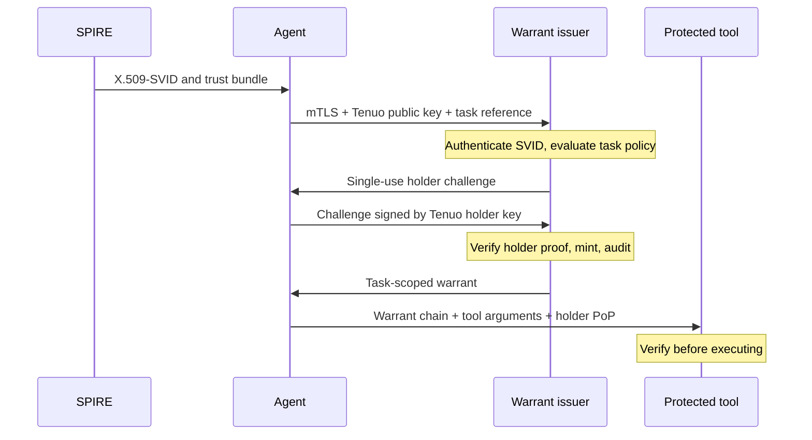

# SPIFFE workload identity and Tenuo task authority

The Python `tenuo.spiffe` adapter authenticates X.509-SVID peers over mTLS and
issues holder-bound warrants after an application policy approves the task.
SPIRE continues to own workload attestation and SVID issuance. Tenuo constrains
subsequent tool calls and delegation.

The adapter supports direct Python TLS termination and a **single trust domain
per TLS context**. It does not implement JWT-SVID exchange, service-mesh
identity headers, or federated bundle selection. It reads SVIDs from files
written by SPIRE tooling (for example `spiffe-helper`) and reloads them as they
rotate.



## Installation

From a checkout containing this adapter (Rust build tools required):

```bash
python -m pip install './tenuo-python[spiffe]'
```

After this feature is released, the equivalent package extra is `tenuo[spiffe]`.
See the [demo](../tenuo-python/examples/spiffe/README.md) for a source-overlay
quickstart that uses the published native extension without building Rust.

## Run the issuer

The issuer is its own mTLS endpoint. It does not need to sit inside your web
framework, and protected tools need no SPIFFE code: they verify warrants.

```python
import asyncio

from tenuo import Exact, Range
from tenuo.spiffe import SpiffeGrant, SpiffeIssuerServer, SpiffeTLS, SpiffeWarrantIssuer

transport = SpiffeTLS(
    trust_domain="acme.test",
    bundle_file="/run/spiffe/bundle.pem",
    cert_file="/run/spiffe/svid.pem",
    key_file="/run/spiffe/svid_key.pem",
    server_side=True,
)

# Example trusted control-plane record, not caller-supplied warrant constraints.
approved_tasks = {
    "refund-task-123": ("spiffe://acme.test/agents/refund", "123", 5000),
}

def policy(identity, task_id):
    task = approved_tasks.get(task_id)
    if task is None or task[0] != identity.spiffe_id:
        return None
    return SpiffeGrant(
        capabilities={"refund": {"customer": Exact(task[1]), "cents": Range(1, task[2])}},
        ttl_seconds=120,
        max_depth=1,
    )

def audit(record):
    # Persist before the warrant is released. Raising here withholds the warrant.
    audit_store.write(record.identity.spiffe_id, record.task_id, record.holder, record.warrant_id)

issuer = SpiffeWarrantIssuer(
    tls=transport,
    signing_key=load_issuer_key(),  # Your managed issuer key.
    policy=policy,
    audit=audit,
)

async def main():
    async with SpiffeIssuerServer(issuer, host="0.0.0.0", port=8443) as server:
        await server.serve_forever()

asyncio.run(main())
```

`SpiffeIssuerServer` runs one exchange per connection with newline-delimited
JSON frames of at most 64 KiB, a 10-second deadline per exchange (`timeout`),
and at most 256 concurrent connections (`max_connections`). Policy and audit
callbacks run in worker threads, so they may block on a database.

## Request a warrant from an agent

```python
from tenuo import PublicKey, SigningKey
from tenuo.spiffe import SpiffeTLS, request_warrant

transport = SpiffeTLS(
    trust_domain="acme.test",
    bundle_file="/run/spiffe/bundle.pem",
    cert_file="/run/spiffe/svid.pem",
    key_file="/run/spiffe/svid_key.pem",
    server_side=False,
)
holder_key = SigningKey.generate()  # Stays in this process.

warrant = request_warrant(
    transport,
    ("issuer.acme.internal", 8443),
    issuer_id="spiffe://acme.test/issuer",
    issuer_key=PublicKey.from_bytes(TRUSTED_ISSUER_KEY),
    holder_key=holder_key,
    task_id="refund-task-123",
)
```

`request_warrant` checks the issuer's SPIFFE ID before sending anything. It signs
only a well-formed challenge naming this holder key, task, issuer key, and its
own SPIFFE ID. It then checks that the warrant is signed by `issuer_key`, bound
to `holder_key`, and unexpired. `arequest_warrant` is the async form.

## Lower-level API

To embed issuance in a server you already run, terminate TLS with
`transport.context` and pass the live `SSLSocket` or `SSLObject`:

```python
challenge = issuer.challenge(tls_connection, holder_public_key, "refund-task-123")
# Agent: signature = sign_holder_challenge(challenge, holder_key, task_id=..., issuer_key=...)
warrant = issuer.issue(tls_connection, challenge, signature)
```

Common ASGI servers (Uvicorn, Hypercorn) and gRPC do not give applications the
TLS connection object. Run `SpiffeIssuerServer` alongside them instead.

Agents must sign challenges with `sign_holder_challenge`, which checks the
challenge and adds the holder-binding context itself. Signatures made directly
over the challenge bytes are rejected. Clients that open their own connections
must call `authenticate(connection, expected_id=...)` before sending a holder
proof or other application data: CA trust alone does not pin the intended
server.

## Policy, limits, and audit

- **Policy is mandatory and runs first.** It is called once per challenge
  request with the authenticated identity and task reference. A denied
  workload gets no challenge. Resolve the task reference against authenticated
  user/workflow state; a caller-supplied task ID is not consent.
- **Grants are validated.** Every tool needs constraints. Use `ANY_ARGUMENTS`
  to allow any arguments; an empty constraint dict is rejected. `ttl_seconds`
  must be a positive integer and `max_depth` an integer from 0 to 64.
- **Challenges** bind the issuer key, certificate fingerprint, SPIFFE ID,
  holder key, task reference, and a random nonce. They expire after 30 seconds,
  are consumed by any redemption attempt, and must be redeemed with the same
  SVID on the same issuer instance. The approved grant is held with the
  challenge, so policy changes take effect for the next challenge.
- **Bounded state.** `max_pending` (default 1024) bounds outstanding challenges
  and `max_pending_per_identity` (default 16) bounds them per SPIFFE ID. Raise
  the latter if many replicas share one ID and request warrants at once.
- **Audit.** `audit` receives a `SpiffeIssuance` (identity, task, holder key,
  warrant ID, expiry, tools) before release. If it raises, the warrant is not
  released. Issuances and refusals are also logged to the `tenuo.spiffe` logger.

## Credential rotation

SPIRE issues short-lived SVIDs (one hour by default) and rotates trust bundles.
Configure your SPIRE helper to write the certificate, key, and bundle files,
ideally by atomic rename.

- `SpiffeIssuerServer` checks the files every `reload_interval` seconds
  (default 30), and `request_warrant` checks them before each request.
- In your own servers, call `transport.reload_if_changed()` periodically, or
  `transport.reload()` when the helper signals new files.
- On the server side, `transport.context` is a stable listener context: each new
  handshake uses the newest SVID and bundle, so listeners are never rebuilt.
  On the client side, read `transport.context` for each new connection.
- A failed reload (partial write, key mismatch, wrong trust domain, expired
  SVID) keeps the current credentials and is retried on the next check. The
  adapter logs a warning when the local SVID enters the last fifth of its
  lifetime without being renewed.
- When a reload removes an authority from the bundle, connections made under
  the old bundle are rejected and must reconnect.

## Enforcement and operational boundaries

- **Keep the trust bundle domain-specific.** The context loads only the supplied
  bundle, which must contain only CA certificates, with no public or system
  roots. Do not combine authorities for unrelated domains.
- **Terminate TLS in the adapter's process.** Never pass a forwarded identity
  header or a certificate from a request body.
- **Separate keys.** SVID keys authenticate transport. Tenuo Ed25519 keys hold
  warrant authority and never leave the agent.
- **Expiry is bounded.** The issued warrant cannot outlive the caller's SVID.
  Earlier revocation of a workload identity does not automatically revoke its
  already-issued warrants. Use short lifetimes and your verifier's revocation
  policy where immediate revocation is required.
- **Enforce every tool call.** Verify root trust, the full delegation chain,
  holder PoP, expiry, and actual arguments before side effects. `max_depth=0`
  makes grants terminal by default; policy must explicitly permit delegation.
- **Per-call amounts are not cumulative budgets.** A $50 argument ceiling does
  not cap total refunds across repeated authorized calls. Transaction
  idempotency, aggregate spending limits, and approval consumption belong in
  the business service or a stateful budget mechanism.
- **Scale-out.** Challenges are local to an issuer process. `SpiffeIssuerServer`
  keeps both steps on one connection, so load balancers need no session
  affinity. Rate-limit issuance at the network edge as well.
- **Offline verifiers.** The warrant binds its holder key; it does not itself
  prove a SPIFFE identity to a tool. Use the audit record to associate them.

## References

- [SPIFFE ID specification](https://spiffe.io/docs/latest/spiffe-specs/spiffe-id/)
- [X.509-SVID specification](https://spiffe.io/docs/latest/spiffe-specs/x509-svid/)
- [Workload API and credential delivery](https://spiffe.io/docs/latest/deploying/svids/)
- [Runnable demo and real SPIRE harness](../tenuo-python/examples/spiffe/README.md)
