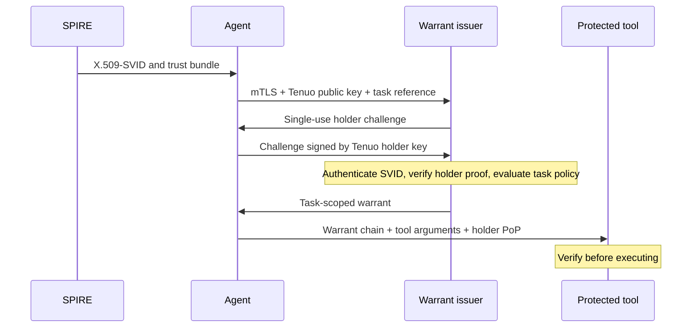

# SPIFFE workload identity and Tenuo task authority

The Python `tenuo.spiffe` adapter authenticates X.509-SVID peers over mTLS and
issues holder-bound warrants after an application policy approves the task.
SPIRE continues to own workload attestation and SVID issuance. Tenuo constrains
subsequent tool calls and delegation.

This first adapter supports direct Python TLS termination and a **single trust
domain per TLS context**. It does not implement the Workload API, JWT-SVID
exchange, service-mesh identity headers, or federated bundle selection.



## Installation

From a checkout containing this adapter (Rust build tools required):

```bash
python -m pip install './tenuo-python[spiffe]'
```

After this feature is released, the equivalent package extra is `tenuo[spiffe]`.
See the [demo](../tenuo-python/examples/spiffe/README.md) for a source-overlay
quickstart that uses the published native extension without building Rust.

## Configure identity and task policy

```python
from tenuo import Exact, Range, SigningKey
from tenuo.spiffe import SpiffeGrant, SpiffeTLS, SpiffeWarrantIssuer

transport = SpiffeTLS(
    trust_domain="acme.test",
    bundle_file="/run/spiffe/bundle.pem",
    cert_file="/run/spiffe/issuer.pem",
    key_file="/run/spiffe/issuer-key.pem",
    server_side=True,
)

# Example trusted control-plane record, not caller-supplied warrant constraints.
approved_tasks = {
    "refund-task-123": ("spiffe://acme.test/agents/refund", "123", 5000),
}

def policy(identity, task_id):
    task = approved_tasks.get(task_id)
    if task is None or task[0] != identity.spiffe_id:
        return None
    return SpiffeGrant(
        capabilities={"refund": {"customer": Exact(task[1]), "cents": Range(1, task[2])}},
        ttl_seconds=120,
        max_depth=1,
    )

issuer = SpiffeWarrantIssuer(
    tls=transport,
    signing_key=SigningKey.generate(),  # Load your managed issuer key in production.
    policy=policy,
)
```

Wrap an accepted connection with `transport.context.wrap_socket(...,
server_side=True)`. After the TLS handshake, call:

```python
challenge = issuer.challenge(tls_connection, holder_public_key, "refund-task-123")
# Send challenge to the authenticated agent. It responds with:
# signature = holder_key.sign_raw(challenge)
warrant = issuer.issue(tls_connection, challenge, signature)
```

The challenge binds the issuer key, certificate fingerprint, SPIFFE ID, holder
public key, task reference, and a random nonce. It expires after 30 seconds and
can be consumed once, including failed proof/policy attempts. A different SVID
must start a new exchange. Both steps must reach the same issuer instance.
`max_pending` bounds outstanding challenges (default 1024); expired entries
are pruned on new challenges. Apply endpoint authentication and rate limits at
the service layer as well.

Clients use their own `SpiffeTLS(server_side=False, ...)` and **must** call
`authenticate(connection, expected_id="spiffe://acme.test/issuer")` before
sending a holder proof or other application data. CA trust alone does not pin
the intended server workload. DNS hostname verification is replaced by this
explicit URI identity check, while certificate chain verification stays enabled.

## Enforcement and operational boundaries

- **Policy is mandatory.** An authenticated workload has no default grant.
  Resolve the task reference against authenticated user/workflow state and check
  that the workload may act for that task. A caller-supplied task ID is not consent.
- **Keep the trust bundle domain-specific.** The context loads only the supplied
  bundle, with no public/system roots. Do not combine authorities for unrelated
  domains: that would let one domain's CA assert identities in another domain.
- **Terminate TLS in the adapter's process.** Pass the actual `SSLSocket` or
  `SSLObject` created by its context, never a forwarded identity header or a
  certificate from a request body. Keep the context immutable after creation.
- **Separate keys.** SVID keys authenticate transport. Tenuo Ed25519 keys hold
  warrant authority. The challenge proves possession of the latter, without
  exporting or reusing the former.
- **Rotation is explicit.** Obtain refreshed SVIDs and bundles through SPIRE's
  Workload API or a helper, build a new `SpiffeTLS`/issuer, and replace the old
  listener. This adapter does not watch files. Do not mutate a live context;
  certificate expiry is rechecked even on existing connections.
- **Expiry is bounded.** The issued warrant cannot outlive the caller's SVID.
  Earlier revocation of a workload identity does not automatically revoke its
  already-issued warrants. Use short lifetimes and your verifier's revocation
  policy where immediate revocation is required.
- **Enforce every tool call.** Verify root trust, the full delegation chain,
  holder PoP, expiry, and actual arguments before side effects. Prevent alternate
  access with broader credentials. `max_depth=0` makes grants terminal by default;
  policy must explicitly permit delegation.
- **Per-call amounts are not cumulative budgets.** A $50 argument ceiling does
  not cap total refunds across repeated authorized calls. Transaction idempotency,
  aggregate spending limits, and approval consumption belong in the business
  service or an appropriate stateful budget mechanism.
- **Retain audit associations.** Record the authenticated identity, holder key,
  task reference, and issued warrant ID in the issuer's audit store. The warrant
  binds its holder key; it does not independently prove a SPIFFE identity to an
  offline tool verifier.

## References

- [SPIFFE ID specification](https://spiffe.io/docs/latest/spiffe-specs/spiffe-id/)
- [X.509-SVID specification](https://spiffe.io/docs/latest/spiffe-specs/x509-svid/)
- [Workload API and credential delivery](https://spiffe.io/docs/latest/deploying/svids/)
- [Runnable demo and real SPIRE harness](../tenuo-python/examples/spiffe/README.md)
