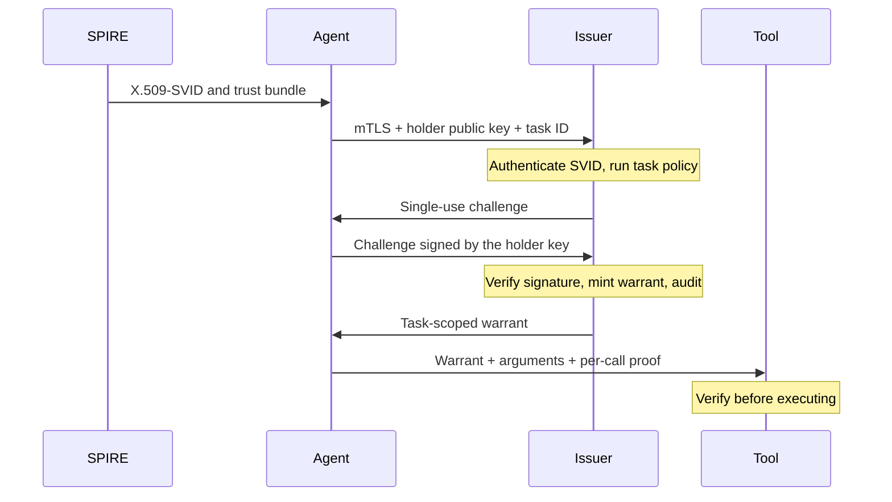

# SPIFFE and Tenuo: task-level authorization for workloads

> Exchange a workload's SPIFFE identity for a short-lived warrant that covers one task.

SPIFFE tells a service which workload is calling. It does not say what that
workload may do for the task in front of it, so a service usually keeps one
allowlist per workload, and every task an agent runs carries the whole
allowlist.

`tenuo.spiffe` adds the missing step. An agent proves its SPIFFE identity and
names a task. Your policy decides what that task needs. The agent gets a
warrant for exactly that: the refund agent working ticket 123 may refund
customer 123 up to $50 for the next two minutes, and may hand a smaller slice
to a worker. The refund tool checks the warrant on every call, which is what
lets you give an agent a write tool without giving it the whole API.

Your SPIRE deployment and existing workloads stay as they are. The issuer is
one more registered workload.

The adapter is Python. It takes SVIDs straight from the SPIRE agent, or from
files. It authenticates agents with X.509-SVIDs over mTLS, or with
[JWT-SVIDs](#jwt-svids-when-mtls-cannot-reach-the-issuer) where mTLS cannot
reach the issuer, or by the identity a
[mesh proxy forwards](#behind-a-service-mesh-identity-forwarded-by-the-proxy)
where agents have only a sidecar. It can accept workloads from
[federated trust domains](#federation-workloads-from-another-trust-domain). Agents in other languages can use the
[wire protocol](#wire-protocol): a
[Node.js client with no dependencies](../tenuo-python/examples/spiffe/clients/request_warrant.mjs)
is tested next to the Python one. Tools can verify warrants with any Tenuo
SDK.

What we run in CI: the exchanges on this page against SPIRE 1.16.0, including
a renewal of both SVIDs and a rotation of the trust domain's signing
authorities while the issuer is serving; the forwarded-identity exchange
through Envoy 1.40.2, and in a cluster with Istio 1.30.8, with Istio's own
certificates and with SPIRE's. The Python blocks that start with a file name
are executed by the test suite.

---

## How the pieces fit

| Question | Answered by | Carried in |
|---|---|---|
| Which workload is this? | SPIRE | An X.509-SVID, checked in the TLS handshake |
| What may it do for this task? | Your policy, run by the issuer | A warrant |
| May this call run? | Tenuo, at the tool | The warrant plus a per-call proof |



Three kinds of process are involved. Only the first two speak SPIFFE:

- **The issuer** is a small service you run. It holds the issuer key and your
  policy.
- **The agent** asks the issuer for a warrant when it starts a task.
- **The tool** (a refund API, an MCP server, a database wrapper) verifies
  warrants. It needs the issuer's public key and no SPIFFE code.

## Terms in two minutes

If you know SPIFFE, skim the second table. If you know Tenuo, skim the first.

| SPIFFE term | Meaning |
|---|---|
| Workload | One running program: here, the issuer or an agent. |
| Trust domain | The namespace one SPIRE deployment vouches for, such as `acme.test`. |
| SPIFFE ID | A URI naming a workload: `spiffe://acme.test/agents/refund`. |
| X.509-SVID | A short-lived certificate carrying one SPIFFE ID. |
| Trust bundle | The CA certificates of a trust domain. A peer's SVID must chain to one of them. |
| mTLS | TLS where both sides present a certificate. Here both present SVIDs. |
| SPIRE server and SPIRE agent | The server signs SVIDs. A SPIRE agent on each node checks which local process is asking (attestation) and hands it its SVID over the Workload API, a Unix socket. |
| Registration entry | A SPIRE server record: processes matching these selectors get this SPIFFE ID. A selector is a fact the SPIRE agent can check, such as `unix:uid:1001`. |
| `spiffe-helper` | A program that fetches an SVID from the Workload API, writes it to files, and rewrites them on renewal. |

On this page "agent" always means your AI agent workload. The SPIRE component
is always called "SPIRE agent".

| Tenuo term | Meaning |
|---|---|
| Warrant | A signed token listing tools, argument constraints, and an expiry, bound to one holder key. |
| Issuer key | The Ed25519 key that signs warrants. Tools trust its public half. |
| Holder key | An Ed25519 key the agent generates and keeps. The warrant names its public half. |
| Proof of possession | A signature the holder makes for each call over the tool name, arguments, and time. A copied warrant is useless without the holder key. |
| Constraint | A rule on one argument: `Exact("123")`, `Range(1, 5000)`, and others in [Constraints](constraints.md). |
| Delegation | The holder signs a narrower child warrant for another key. Verifiers check the whole chain. |

[Concepts](concepts.md) explains warrants in more depth.

## Try it in five minutes, without SPIRE

From a checkout of this repository:

```bash
python -m venv /tmp/tenuo-spiffe-demo-venv
/tmp/tenuo-spiffe-demo-venv/bin/pip install 'tenuo==0.3.8' 'cryptography>=42'
PYTHONPATH=tenuo-python /tmp/tenuo-spiffe-demo-venv/bin/python tenuo-python/examples/spiffe/demo.py
```

The released package supplies Tenuo's compiled core, and `PYTHONPATH` loads the
adapter from the checkout until it ships in a release. The demo creates
throwaway certificates shaped like SVIDs, runs an issuer and an agent on
localhost, and makes four tool calls:

```text
ALLOWED: approved customer, $40
DENIED: different customer
DENIED: over $50 task limit
ALLOWED: delegated worker, $8
Verified: only the two authorized refunds reached the tool body.
```

The [demo README](../tenuo-python/examples/spiffe/README.md) also has a Docker
harness that does the same against a real SPIRE server.

## Set it up with your SPIRE deployment

The steps use one trust domain (`acme.test`), one issuer, and one agent. Each
step says which machine it runs on.

### Before you start

- A working SPIRE server, and a SPIRE agent on each node that will run the
  issuer or an agent. The
  [SPIRE quickstarts](https://spiffe.io/docs/latest/try/) cover that part.
- Python 3.9 or newer for the issuer and the agents.
- The adapter: `pip install 'tenuo[spiffe-workload-api]'` once it is released.
  Until then, install from a checkout with
  `python -m pip install './tenuo-python[spiffe-workload-api]'` (needs Rust
  build tools). The plain `tenuo[spiffe]` extra leaves out `grpcio` and
  supports credential files only.
- A registration entry for the issuer and one for each agent. Run on the SPIRE
  server:

  ```bash
  spire-server entry create -parentID spiffe://acme.test/node-a \
      -spiffeID spiffe://acme.test/issuer -selector unix:uid:1001
  spire-server entry create -parentID spiffe://acme.test/node-b \
      -spiffeID spiffe://acme.test/agents/refund -selector unix:uid:1002
  ```

  `-parentID` is the SPIFFE ID of the SPIRE agent on the node where the
  workload runs. `spire-server agent list` prints them. On Kubernetes the
  selectors are usually `k8s:ns:<namespace>` and `k8s:sa:<service account>`.
  Give the issuer and each agent different selectors, so one workload cannot
  obtain another's SVID.

### Step 1: Give each workload its SVID

*On the issuer's machine and on each agent's machine.*

The adapter needs the workload's SVID, its private key, and the trust bundle.
There are two ways to supply them. The steps below use the first.

**Option A: the Workload API (recommended).** The adapter connects to the SPIRE
agent's socket, takes the SVID from it, and follows renewals. There is nothing
extra to run and no key file to manage: on Linux the private key stays in
memory. The workload only needs to reach the socket:

```python
transport = SpiffeTLS.from_workload_api(
    trust_domain="acme.test",
    socket_path="/run/spire/sockets/agent.sock",
    server_side=True,  # False in agents.
)
```

- Leave out `socket_path` to use the `SPIFFE_ENDPOINT_SOCKET` environment
  variable, the SPIFFE convention. A `tcp://IP:PORT` address is accepted for
  loopback only: the Workload API is unencrypted and hands out private keys, so
  it must stay on the machine.
- SPIRE decides which SVID to hand out from the process that connects, so the
  issuer or agent process itself must match its registration entry's selectors.
- If SPIRE offers the process more than one SVID, the adapter uses the first.
  Pass `spiffe_id="spiffe://acme.test/issuer"` to choose.
- The call waits up to 30 seconds for an SVID, asking again every 2 seconds,
  so a workload that starts before its registration entry reaches the SPIRE
  agent still comes up.

Check what SPIRE will hand out, as the workload's user:

```bash
spire-agent api fetch x509 -socketPath /run/spire/sockets/agent.sock
```

It prints `SPIFFE ID:` and `SVID Valid Until:` for each SVID. An error
containing `no identity issued` means no registration entry matches.

**Option B: credential files.** Use this when you would rather not add `grpcio`,
or when other software on the host needs the same files. Run
[`spiffe-helper`](https://github.com/spiffe/spiffe-helper) beside each
workload:

```hcl
# helper.conf
agent_address = "/run/spire/sockets/agent.sock"   # The SPIRE agent's socket.
cert_dir = "/run/spiffe"                          # Must already exist.
svid_file_name = "svid.pem"
svid_key_file_name = "svid_key.pem"
svid_bundle_file_name = "svid_bundle.pem"
key_file_mode = 0600
```

```bash
spiffe-helper -config helper.conf
```

Run the helper as the same Unix user (or in the same pod) as the workload it
serves, so that it matches the workload's selectors and the workload can read
the key file. The helper keeps running and replaces the files atomically when
SPIRE renews the SVID. Leave `include_federated_domains` off: the bundle file
must hold only your own trust domain's authorities. The adapter rejects CA
certificates tagged with another trust domain, but a CA certificate does not
have to carry a SPIFFE ID.

Check the result with
`openssl x509 -in /run/spiffe/svid.pem -noout -text | grep URI:`, which prints
`URI:spiffe://acme.test/issuer`. Then build the transport from the files, in
place of `from_workload_api` in steps 3 and 4:

```python
# transport_from_files.py
from tenuo.spiffe import SpiffeTLS

transport = SpiffeTLS(
    trust_domain="acme.test",
    bundle_file="/run/spiffe/svid_bundle.pem",
    cert_file="/run/spiffe/svid.pem",
    key_file="/run/spiffe/svid_key.pem",
    server_side=True,  # False in agents.
)
```

### Step 2: Create the issuer key

*Once, on an administrator's machine.*

```python
# make_issuer_key.py
from pathlib import Path

from tenuo import SigningKey

key = SigningKey.generate()
private = Path("tenuo-issuer.pem")
private.touch(mode=0o600)
private.write_text(key.to_pem())
Path("tenuo-issuer.pub").write_text(key.public_key.to_pem())
```

This key is separate from any SVID key. It signs every warrant.

- Put `tenuo-issuer.pem` in your secret manager and mount it only into the
  issuer. This page assumes `/run/secrets/tenuo-issuer.pem`. All issuer
  replicas share it.
- Ship `tenuo-issuer.pub` to every agent and tool. This page assumes
  `/etc/tenuo/tenuo-issuer.pub`. It is public.

To rotate the key later, see [Issuer key rotation](#issuer-key-rotation).

### Step 3: Run the issuer

*On the issuer's machine.*

```python
# issuer.py
import asyncio
import logging
from pathlib import Path

from tenuo import Exact, Range, SigningKey
from tenuo.spiffe import SpiffeGrant, SpiffeIssuerServer, SpiffeTLS, SpiffeWarrantIssuer

logging.basicConfig(level=logging.INFO)
audit_log = logging.getLogger("acme.warrant-audit")

transport = SpiffeTLS.from_workload_api(
    trust_domain="acme.test",
    socket_path="/run/spire/sockets/agent.sock",
    server_side=True,
)

# Stand-in for your task system: which workload may work on which task.
approved_tasks = {
    "refund-task-123": {"agent": "spiffe://acme.test/agents/refund", "customer": "123", "max_cents": 5000},
}


def policy(identity, task_id):
    task = approved_tasks.get(task_id)
    if task is None or task["agent"] != identity.spiffe_id:
        return None  # Deny.
    return SpiffeGrant(
        capabilities={"refund": {"customer": Exact(task["customer"]), "cents": Range(1, task["max_cents"])}},
        ttl_seconds=120,
        max_depth=1,  # The agent may delegate once. 0 forbids delegation.
    )


def audit(record):
    # Called before the warrant is released. If this raises, no warrant is sent.
    audit_log.info(
        "warrant=%s workload=%s task=%s holder=%s tools=%s expires=%s",
        record.warrant_id,
        record.identity.spiffe_id,
        record.task_id,
        record.holder,
        ",".join(record.tools),
        record.expires_at,
    )


issuer = SpiffeWarrantIssuer(
    tls=transport,
    signing_key=SigningKey.from_pem(Path("/run/secrets/tenuo-issuer.pem").read_text()),
    policy=policy,
    audit=audit,
)


async def main():
    async with SpiffeIssuerServer(issuer, host="0.0.0.0", port=8443) as server:
        await server.serve_forever()


asyncio.run(main())
```

Run `python issuer.py`. It logs its SVID, then its address, and waits:

```text
INFO:tenuo.spiffe:Loaded SVID spiffe://acme.test/issuer (expires 2026-11-25T22:34:29+00:00)
INFO:tenuo.spiffe:Issuing warrants on 0.0.0.0:8443 as spiffe://acme.test/issuer
```

The server needs no web framework, and it follows SVID renewals for as long as
it runs. [Writing the policy](#writing-the-policy) covers the part you will
replace: `approved_tasks`.

### Step 4: Request a warrant in the agent

*On the agent's machine.*

```python
# agent.py
from pathlib import Path

from tenuo import PublicKey, SigningKey
from tenuo.spiffe import SpiffeTLS, request_warrant

transport = SpiffeTLS.from_workload_api(
    trust_domain="acme.test",
    socket_path="/run/spire/sockets/agent.sock",
    server_side=False,
)
holder_key = SigningKey.generate()  # Never leaves this process.

warrant = request_warrant(
    transport,
    ("issuer.acme.internal", 8443),
    issuer_id="spiffe://acme.test/issuer",
    issuer_key=PublicKey.from_pem(Path("/etc/tenuo/tenuo-issuer.pub").read_text()),
    holder_key=holder_key,
    task_id="refund-task-123",
)
print(warrant.id, warrant.tools, warrant.expires_at())
```

Run `python agent.py`. It prints the new warrant:

```text
tnu_wrt_01a21496aecb7932bff93ec30b660e44 ['refund'] 2026-11-25T21:34:29+00:00
```

and the issuer logs the issuance and your audit line.

`request_warrant` checks the issuer's SPIFFE ID before it sends anything. It
also checks that the warrant it gets back is signed by `issuer_key`, bound to
`holder_key`, and unexpired. Every failure raises `SpiffeError` with a message
that says what went wrong; [Troubleshooting](#troubleshooting) lists them.
`arequest_warrant` is the same call for asyncio code.

In a real agent, build one `SpiffeTLS` and one holder key at startup and
request a new warrant for each task.

### Step 5: Call the tool, and verify at the tool

The agent signs each call with its holder key and sends three things over
whatever transport it already uses: the warrant, the arguments, and the proof.
Append this to `agent.py`:

```python
# call_tool.py  (append to agent.py)
import base64
import time

args = {"customer": "123", "cents": 4000}
proof = warrant.sign(holder_key, "refund", args, int(time.time()))
call = {"chain": [warrant.to_base64()], "args": args, "proof": base64.b64encode(proof).decode()}
```

*On the tool's machine*, check the call before doing anything:

```python
# tool.py
import base64
from pathlib import Path

from tenuo import Authorizer, PublicKey, Warrant
from tenuo.exceptions import TenuoError

authorizer = Authorizer(trusted_roots=[PublicKey.from_pem(Path("/etc/tenuo/tenuo-issuer.pub").read_text())])


def refund(call):
    try:
        chain = [Warrant.from_base64(item) for item in call["chain"]]
        authorizer.check_chain(chain, "refund", call["args"], base64.b64decode(call["proof"]))
    except (TenuoError, KeyError, TypeError, ValueError) as denied:
        return f"denied: {denied}"
    # Only now touch the payment system.
    return f"refunded {call['args']['cents']} cents to customer {call['args']['customer']}"
```

`refund(call)` returns `refunded 4000 cents to customer 123`. Change the
customer to `999` or the amount to `6000` and it returns `denied: ...`, even
though the agent's SVID is perfectly valid. `check_chain` verifies the issuer
signature, the expiry, the proof, and the actual arguments.

If the tool is a FastAPI route or an MCP server, use the [FastAPI](fastapi.md)
or [MCP](mcp.md) guide instead of writing this function: they carry the same
three values in headers or request metadata. Write it by hand for anything
else.

A proof is valid for a short window (150 seconds by default,
`Authorizer.pop_validity_secs()`), so keep clocks synchronized to within about
a minute, and make side effects idempotent: the same call can be repeated
inside that window.

### Step 6: Delegate a narrower warrant (optional)

Because the policy set `max_depth=1`, the agent can hand part of its authority
to a worker without going back to the issuer. The child can only be narrower.
Append this to `agent.py`, after the step 5 code:

```python
# delegate.py  (append to agent.py)
from tenuo import Exact, Range

worker_key = SigningKey.generate()  # In a real system the worker generates this and sends you the public half.
child = (
    warrant.grant_builder()
    .holder(worker_key.public_key)
    .ttl(30)
    .capability("refund", customer=Exact("123"), cents=Range(1, 1000))
    .grant(holder_key)
)

worker_args = {"customer": "123", "cents": 800}
worker_proof = child.sign(worker_key, "refund", worker_args, int(time.time()))
worker_call = {
    "chain": [warrant.to_base64(), child.to_base64()],
    "args": worker_args,
    "proof": base64.b64encode(worker_proof).decode(),
}
```

The tool code from step 5 accepts `worker_call` unchanged and denies the worker
anything over 1000 cents. Send the worker both warrants over the channel you
already use to hand it work. Warrants and public keys are not secrets: a
warrant is only usable with its holder's private key. They do reveal the scope
of the task.

---

## JWT-SVIDs, when mTLS cannot reach the issuer

The steps above need the agent's TLS connection to end inside the issuer. Some
deployments cannot give you that: a load balancer that terminates TLS, a
service mesh sidecar you cannot bypass, a serverless platform. For those, the
agent can present a JWT-SVID instead, as a bearer token over HTTPS.

Use mTLS where you can. The JWT-SVID standard says why: "Being a bearer token,
JWT-SVIDs are susceptible to replay attacks"
([JWT-SVID, section 7.1](https://github.com/spiffe/spiffe/blob/main/standards/JWT-SVID.md)).
Anyone who obtains the token can use it until it expires. With mTLS there is
nothing to steal from the wire.

The adapter narrows that gap as far as a bearer token allows:

- The token must name this issuer as its audience. A token an agent requested
  for any other service is refused.
- The warrant never outlives the token. SPIRE's default JWT-SVID lifetime is
  five minutes (`default_jwt_svid_ttl`).
- The agent's holder key signs a statement bound to that exact token, this
  audience, the task, and the current time. A captured request can only produce
  a warrant for the same holder key, which the thief does not have. An issuer
  process also refuses an exact repeat of a request it has already served, for
  as long as that request's timestamp would still be accepted.
- The bundled client sends the token only over verified HTTPS and does not
  follow redirects.

What it cannot do: someone who steals the token itself, before it expires, can
enrol a holder key of their own and get a warrant for any task that workload is
assigned. Keep token lifetimes short and treat every hop that sees the token as
trusted.

The exchange is a single request and replicas share no state, so issuer
replicas behind a load balancer need no session affinity. A request that fails
(a policy error, a dropped connection) can simply be sent again.

### Install

```bash
pip install 'tenuo[spiffe-jwt,spiffe-workload-api]' uvicorn
```

`spiffe-jwt` adds PyJWT. Any ASGI server works in place of Uvicorn.

### Run the JWT issuer

*On the issuer's machine. The issuer key and the policy are the same as in
steps 2 and 3.*

```python
# jwt_issuer.py
import logging
from pathlib import Path

from tenuo import Exact, Range, SigningKey
from tenuo.spiffe import SpiffeGrant, SpiffeWarrantIssuer
from tenuo.spiffe_jwt import SpiffeJWT, SpiffeJWTIssuerApp

logging.basicConfig(level=logging.INFO)

tokens = SpiffeJWT.from_workload_api(
    trust_domain="acme.test",
    audience="spiffe://acme.test/issuer",  # Agents must request tokens for exactly this.
    socket_path="/run/spire/sockets/agent.sock",
)

approved_tasks = {
    "refund-task-123": {"agent": "spiffe://acme.test/agents/refund", "customer": "123", "max_cents": 5000},
}


def policy(identity, task_id):
    task = approved_tasks.get(task_id)
    if task is None or task["agent"] != identity.spiffe_id:
        return None
    # Optional: grant less to a bearer token than to an mTLS peer.
    limit = task["max_cents"] if identity.svid_type == "x509" else min(task["max_cents"], 2000)
    return SpiffeGrant(
        capabilities={"refund": {"customer": Exact(task["customer"]), "cents": Range(1, limit)}},
        ttl_seconds=120,
    )


issuer = SpiffeWarrantIssuer(
    signing_key=SigningKey.from_pem(Path("/run/secrets/tenuo-issuer.pem").read_text()),
    policy=policy,
    jwt=tokens,
)
app = SpiffeJWTIssuerApp(issuer)
```

```bash
uvicorn jwt_issuer:app --host 0.0.0.0 --port 8080
```

Put your TLS-terminating load balancer or mesh in front of that port. The
issuer takes the trust domain's JWT signing keys from the SPIRE agent and
follows key rotation. Signing keys carry no expiry date, so the issuer does not
keep trusting them on old information. If SPIRE withdraws the keys, tokens are
refused at once. If SPIRE refuses the issuer its own identity for 30 seconds,
or the SPIRE agent is unreachable for five minutes (`max_stale_seconds`) or
sends only JWT bundles the issuer cannot read for that long, tokens are
refused until a readable update arrives. This includes malformed Workload API
messages; receiving unreadable bytes does not restart the grace period. An
unreadable bundle for the issuer's own trust domain stops that domain's tokens
only: a federated domain whose bundle in the same response was read is still
accepted. The 30
seconds are deliberate: a SPIRE agent answers "no identity issued" for a
moment while it replaces a workload's SVIDs after a forced rotation (about a
second with SPIRE 1.16.0, when we tainted an authority), and tokens stay valid
through that.

`audience` is the name agents request tokens for. Make it specific to this
issuer; its SPIFFE ID is the usual choice.

One issuer can serve both kinds of SVID. Pass `tls=` and `jwt=` together, run
`SpiffeIssuerServer` and the ASGI app from the same `SpiffeWarrantIssuer`, and
they share one policy and one audit log. `identity.svid_type` is `"x509"` or
`"jwt"` in both.

### Request a warrant with a JWT-SVID

*On the agent's machine.*

```python
# jwt_agent.py
from pathlib import Path

from tenuo import PublicKey, SigningKey
from tenuo.spiffe_jwt import fetch_jwt_svid, request_warrant_jwt

AUDIENCE = "spiffe://acme.test/issuer"
holder_key = SigningKey.generate()  # Never leaves this process.

warrant = request_warrant_jwt(
    "https://issuer.acme.internal/warrants",
    token=lambda: fetch_jwt_svid(AUDIENCE, socket_path="/run/spire/sockets/agent.sock"),
    audience=AUDIENCE,
    issuer_key=PublicKey.from_pem(Path("/etc/tenuo/tenuo-issuer.pub").read_text()),
    holder_key=holder_key,
    task_id="refund-task-123",
)
print(warrant.id, warrant.tools, warrant.expires_at())
```

`fetch_jwt_svid` asks the SPIRE agent for a token for that audience. The
server's TLS certificate is checked against the system roots; pass
`ca_file="/path/to/ca.pem"` for a private CA. Plain `http://` is accepted for
loopback addresses only. From here on nothing differs: steps 5 and 6 work with
this warrant unchanged.

If the warrant comes back shorter than the policy's `ttl_seconds`, the token
was close to expiry. Raise the entry's JWT-SVID lifetime with
`spire-server entry create ... -jwtSVIDTTL <seconds>` if tasks need longer.

**With files.** `spiffe-helper` can write both sides' inputs (`jwt_svids` and
`jwt_bundle_file_name` in its config). On the issuer, use
`SpiffeJWT(trust_domain=..., audience=..., bundle_file="/run/spiffe/jwt_bundle.json")`;
a changed file is picked up within a few seconds. A bundle in SPIFFE format
(`spire-server bundle show -format spiffe`) works too; from it only the keys
marked `jwt-svid` are used. On the agent, pass
`token=lambda: Path("/run/spiffe/jwt_svid.token").read_text()`.

---

## Behind a service mesh: identity forwarded by the proxy

In a service mesh, the sidecar in front of the issuer ends the agent's mutual
TLS. The issuer receives a plain HTTP request and never sees the SVID. Envoy,
and meshes built on it, can pass the client certificate's details on in the
`x-forwarded-client-cert` header
([Envoy reference](https://www.envoyproxy.io/docs/envoy/latest/configuration/http/http_conn_man/headers#x-forwarded-client-cert)),
and the adapter can take the agent's identity from it. Agents then need no
SPIFFE code: their sidecar holds the SVID.

**Read this before choosing it.** In the other two modes the issuer verifies
the SVID itself. Here it believes a header. The identity is exactly as
trustworthy as two things you operate:

- **The proxy's configuration.** It must require a client certificate, verify
  it against the trust bundle, and replace any `x-forwarded-client-cert` the
  client sent.
- **The path from the proxy to the issuer.** Anything that can connect to the
  issuer's port from the proxy's address can write the header itself and name
  any workload. With a sidecar on loopback, that is every container in the
  pod.

If you can keep the issuer port out of the mesh, do that and use mTLS
([deployment notes](#deployment-notes)). If agents can reach the SPIRE agent,
[JWT-SVIDs](#jwt-svids-when-mtls-cannot-reach-the-issuer) pass through the mesh
and are verified by the issuer. Use forwarded identity when neither is open to
you, usually because agents have a sidecar and nothing else.

What the adapter does with the trust you give it:

- It accepts requests only from the addresses you list in `trusted_proxies`.
  There is no default.
- The header must describe exactly one client certificate with exactly one
  URI. A header with more entries is refused: the client sent one of its own,
  or the request crossed a second proxy.
- The proxy must forward the certificate itself, and the issuer checks the
  SPIFFE ID against it rather than taking the header's word: it must be the
  certificate the header's hash names, be valid now, and carry exactly one URI
  name, equal to the forwarded one. Warrants never outlive the certificate,
  and last at most `max_warrant_seconds` (300 by default) whatever the policy
  grants. The issuer holds no trust bundle in this mode, so it does not check
  who signed the certificate. That stays the proxy's job.
- Istio's generated configuration does not forward the certificate.
  `require_certificate=False` accepts a header without it
  ([With Istio](#with-istio)), and the issuer then takes the proxy's reading
  of the name. Envoy 1.40.2 copies URI and DNS names from the certificate into
  the header unescaped, so a certificate with a separator or a quote in a name
  can add text of its own. The adapter therefore requires the URI to be the
  last thing in the header. It reads the name to its end and never stops at a
  separator inside it, with or without a header sent by the client. A header
  that carries DNS names after the URI and no certificate is refused for the
  same reason, unless you opt in with `allow_dns_names`. Spaces and tabs at
  the end of a name are the exception: they are gone before the adapter sees
  the header ([Limits of this mode](#limits-of-this-mode)).
- A request is counted against its SPIFFE ID from before its body is read, and
  at most 16 from one ID are in progress at once (`max_per_identity`).
- The agent's holder key signs a statement bound to this issuer's `audience`,
  the task, and the current time. A captured request is no use at another
  issuer or for another task, and can only produce a warrant for the same
  holder key.

### Configure the proxy

In the `HttpConnectionManager` of the Envoy listener in front of the issuer:

```yaml
forward_client_cert_details: SANITIZE_SET
set_current_client_cert_details:
  uri: true
  cert: true
```

`cert: true` adds about a kilobyte to each request and lets the issuer check
the SPIFFE ID against the certificate, as described above. Without it the
issuer refuses every request, unless you pass `require_certificate=False` to
`SpiffeForwardedIdentity` and accept
[what that leaves to the proxy](#limits-of-this-mode).

The listener's TLS settings must set `require_client_certificate: true` and a
validation context with the trust bundle.

| Envoy mode | What we observed with Envoy 1.40.2 | Use it? |
|---|---|---|
| `SANITIZE_SET` | Replaces whatever the client sent with the verified certificate's details. | Yes |
| `APPEND_FORWARD` | Adds its entry after the client's. The issuer refuses requests where the client sent a header. | Yes |
| `SANITIZE` (the default) | Sends no header. The issuer refuses every request. | No |
| `FORWARD_ONLY`, `ALWAYS_FORWARD_ONLY` | Passes a client's made-up header through unchanged. | Never |

Without `uri: true` Envoy sends the certificate hash and no SPIFFE ID, and the
issuer refuses the request. `dns` may be on: DNS names follow the URI and are
accepted, because the certificate vouches for the URI. With
`require_certificate=False` and no `cert`, leave `dns` off, or the issuer
refuses certificates that have DNS names. `subject` and `chain` may be on;
they come before the URI. On a listener without client certificates Envoy
removed the header in every mode except `ALWAYS_FORWARD_ONLY`.

Istio configures Envoy for you: its mode fits, and it does not forward the
certificate. See [With Istio](#with-istio) below. For another mesh, check
which mode it uses for the issuer's inbound listener, and whether it forwards
the certificate, before relying on it.

### Run the issuer behind the proxy

*On the issuer's machine. The issuer key and the policy are the same as in
steps 2 and 3.*

```bash
pip install 'tenuo[spiffe]' uvicorn
```

```python
# forwarded_issuer.py
import logging
from pathlib import Path

from tenuo import Exact, Range, SigningKey
from tenuo.spiffe import SpiffeGrant, SpiffeWarrantIssuer
from tenuo.spiffe_forwarded import SpiffeForwardedIdentity, SpiffeForwardedIssuerApp

logging.basicConfig(level=logging.INFO)

forwarded = SpiffeForwardedIdentity(
    "acme.test",
    audience="https://issuer.acme.internal/warrants",  # A name for this issuer. Agents sign it.
    trusted_proxies=["127.0.0.1"],  # Where the sidecar connects from. Nothing else is accepted.
)

approved_tasks = {
    "refund-task-123": {"agent": "spiffe://acme.test/agents/refund", "customer": "123", "max_cents": 5000},
}


def policy(identity, task_id):
    task = approved_tasks.get(task_id)
    if task is None or task["agent"] != identity.spiffe_id:
        return None
    # Optional: grant less to an identity the issuer could not verify itself.
    limit = task["max_cents"] if identity.svid_type == "x509" else min(task["max_cents"], 2000)
    return SpiffeGrant(
        capabilities={"refund": {"customer": Exact(task["customer"]), "cents": Range(1, limit)}},
        ttl_seconds=120,
    )


issuer = SpiffeWarrantIssuer(
    signing_key=SigningKey.from_pem(Path("/run/secrets/tenuo-issuer.pem").read_text()),
    policy=policy,
    forwarded=forwarded,
)
app = SpiffeForwardedIssuerApp(issuer)
```

```bash
uvicorn forwarded_issuer:app --host 127.0.0.1 --port 8080 --no-proxy-headers
```

Two details in that command matter:

- **`--host 127.0.0.1`.** Bind to an address only the proxy can reach. An
  issuer listening on the pod's network address can be reached around the
  proxy.
- **`--no-proxy-headers`.** The issuer must be given the real socket peer. By
  default Uvicorn replaces the client address with one from `X-Forwarded-For`
  when a request from loopback carries that header. Envoy passes a client's
  `X-Forwarded-For` through, and adds one itself with `use_remote_address`, so
  without this switch some or all requests are refused. Leave
  `--forwarded-allow-ips` and the `FORWARDED_ALLOW_IPS` environment variable
  unset as well. As a backstop, the issuer refuses a client address with port
  0, which is how Uvicorn reports one it took from a header.

Meshes differ in the address their sidecar connects from, and to. If the
issuer refuses its own proxy, its warning on the `tenuo.spiffe` logger shows
the address it saw (at most once a minute); set `trusted_proxies` and `--host`
to match. Istio needs different values from the ones above:
see [With Istio](#with-istio).

**Other ASGI servers.** The peer check depends on what the server reports as
the client address, so we start each of these the way the table shows, over
TCP and over a Unix socket, and send requests that claim the proxy's address
in `X-Forwarded-For` and `Forwarded`. None of them let a caller choose its
address.

| Server (version tested) | Start it with | Notes |
|---|---|---|
| Uvicorn 0.54 | `uvicorn forwarded_issuer:app --host 127.0.0.1 --port 8080 --no-proxy-headers` | |
| Gunicorn 27 with uvicorn-worker 0.4 | `gunicorn forwarded_issuer:app -k workers.NoProxyHeaders --bind 127.0.0.1:8080` | Gunicorn has no switch for address rewriting. Use the worker below. |
| Hypercorn 0.18 | `hypercorn forwarded_issuer:app --bind 127.0.0.1:8080` | Does not rewrite addresses. |
| Daphne 4.2 | `daphne -b 127.0.0.1 -p 8080 forwarded_issuer:app` | Leave `--proxy-headers` off. |
| Granian 2.8 | `granian --interface asgi forwarded_issuer:app --host 127.0.0.1 --port 8080` | TCP only. Over a Unix socket it reports an empty client address, which the issuer refuses. |

```python
# workers.py
from uvicorn_worker import UvicornWorker


class NoProxyHeaders(UvicornWorker):
    """Gives the application the real socket peer, as uvicorn --no-proxy-headers does."""

    CONFIG_KWARGS = {"proxy_headers": False}
```

With the stock Uvicorn worker, or Uvicorn without the switch, a request that
carries `X-Forwarded-For` is refused. Two checks do that, and they cost
availability, never trust:

- Uvicorn reports an address it took from a bare `X-Forwarded-For` entry with
  port 0, which no connected peer has.
- An entry written as `address:port` gives Uvicorn a port too (Daphne takes
  one from `X-Forwarded-Port`), and the result looks like a real peer. So the
  issuer also refuses a request whose client address is named in its own
  `X-Forwarded-For`, `Forwarded` or `X-Real-IP` header. With Uvicorn 0.54 a
  caller on loopback that sent the proxy's address this way was refused, in
  both forms and with `FORWARDED_ALLOW_IPS=*`.

The second check also refuses a caller that really does share the proxy's
address, when the proxy records that caller in `X-Forwarded-For`: a client on
the same host as a loopback proxy, for example. Have the proxy reach the
issuer over a Unix socket in that layout, as described next.

A Unix socket narrows the path further, because file permissions decide who
can connect. Start Uvicorn with `--uds /run/issuer/issuer.sock`, point the
proxy's cluster at that path, and pass `trusted_proxies=[UNIX_SOCKET]` (from
`tenuo.spiffe_forwarded`). List `UNIX_SOCKET` only when the server listens on
nothing else.

Set `expected_by="spiffe://acme.test/issuer"` to also require that the header
names your proxy's own SPIFFE ID as the one that recorded the client.

`identity.svid_type` is `"forwarded"` in the policy and the audit record, and
`identity.certificate_sha256` is the certificate hash the proxy reported. One
issuer can serve all three kinds: pass `tls=`, `jwt=` and `forwarded=` together.

### Request a warrant through the sidecar

*On the agent's machine.*

```python
# forwarded_agent.py
from pathlib import Path

from tenuo import PublicKey, SigningKey
from tenuo.spiffe_forwarded import request_warrant_forwarded

holder_key = SigningKey.generate()  # Never leaves this process.

warrant = request_warrant_forwarded(
    "http://issuer.acme.internal/warrants",  # Plain HTTP here: the sidecar adds mutual TLS.
    audience="https://issuer.acme.internal/warrants",
    issuer_key=PublicKey.from_pem(Path("/etc/tenuo/tenuo-issuer.pub").read_text()),
    holder_key=holder_key,
    task_id="refund-task-123",
)
print(warrant.id, warrant.tools, warrant.expires_at())
```

The agent sends no credential of its own. If its sidecar is not adding mutual
TLS, the issuer's proxy sees no client certificate and the request is refused.
The reply needs no secrecy inside the pod: a warrant is only usable with its
holder's private key. From here on nothing differs: steps 5 and 6 work with
this warrant unchanged.

An agent that holds its own SVID and has no sidecar can open the mutual TLS
connection to the issuer's proxy itself. Pass an `https://` URL with
`tls=SpiffeTLS.from_workload_api(trust_domain="acme.test", server_side=False)`
and `issuer_id="spiffe://acme.test/issuer"`. The client checks the proxy's
SPIFFE ID before it sends anything.

### With Istio

We run this exchange in CI in a throwaway cluster with Istio 1.30.8 in sidecar
mode (its proxy is Envoy 1.38), with the configuration Istio generates. You
can run the same check: it needs `docker`, `kubectl` and `helm`, starts its
own single-node cluster in a container, and uses its own kubeconfig, so your
contexts are not touched.

```bash
python tenuo-python/examples/spiffe/istio/check.py
```

[The manifests beside it](../tenuo-python/examples/spiffe/istio/) are a
starting point for your own. Nothing in the proxy needs configuring. The
issuer needs `require_certificate=False`, because Istio does not forward the
certificate. What the check shows:

- **The inbound listener appends.** Istio generates
  `forward_client_cert_details: APPEND_FORWARD` with `subject`, `dns` and `uri`
  forwarded. The issuer receives
  `By=spiffe://cluster.local/ns/tenuo/sa/issuer;Hash=...;Subject="";URI=spiffe://cluster.local/ns/tenuo/sa/agent`.
  The SPIFFE ID is the caller's namespace and service account, so that is
  what your policy matches on, and `trust_domain` is `cluster.local` unless
  you changed the mesh's. The certificates Istio issues carry no DNS names,
  so the URI ends the header as the issuer requires.
- **The sidecar connects from `127.0.0.6`, to the pod's own address.** With the
  settings shown above (`--host 127.0.0.1`, `trusted_proxies=["127.0.0.1"]`)
  agents got HTTP 503 from the sidecar, and after binding all addresses, 403
  from the issuer. Use `--host 0.0.0.0` and `trusted_proxies=["127.0.0.6"]`.
  A pod that connected straight to the issuer's pod address still arrived
  through the sidecar, and a connection from inside the issuer's pod, from
  loopback or the pod address, was refused. A process inside the issuer's pod
  that binds `127.0.0.6` as its source address is accepted with any header it
  writes, so keep other containers out of that pod.
- **A Unix socket closes that last gap.** Istio can deliver inbound traffic to
  a socket instead of a port. The issuer then has no TCP listener at all:

  ```yaml
  apiVersion: networking.istio.io/v1
  kind: Sidecar
  metadata: {name: issuer, namespace: tenuo}
  spec:
    workloadSelector: {labels: {app: issuer}}
    ingress:
    - port: {number: 8080, protocol: HTTP, name: http}
      defaultEndpoint: unix:///run/issuer/issuer.sock
  ```

  Give the pod an in-memory `emptyDir` volume mounted at `/run/issuer` in the
  issuer container, mount it into the sidecar with the pod annotation
  `sidecar.istio.io/userVolumeMount: '[{"name": "issuer-socket", "mountPath": "/run/issuer"}]'`,
  start Uvicorn with `--uds /run/issuer/issuer.sock --no-proxy-headers`, and
  pass `trusted_proxies=[UNIX_SOCKET]`. The Service and `containerPort` stay
  on 8080.
- **A caller cannot supply the header.** The calling pod's own sidecar removed
  an `x-forwarded-client-cert` the agent sent. A workload that took its mesh
  certificate and connected around its sidecar, sending a complete made-up
  entry, a partial one that opens a quote, two header lines, or a made-up
  `X-Forwarded-For`, was refused every time or served as itself.
- **Without a sidecar there is no identity.** With mutual TLS in Istio's
  default `PERMISSIVE` mode, a pod outside the mesh reaches the issuer in
  plain HTTP; Istio drops any `x-forwarded-client-cert` it sent and the issuer
  answers 403. In `STRICT` mode the connection is reset before that.
- **Through an ingress gateway, the caller is the gateway.** A request that
  enters through an Istio gateway in plain HTTP reaches the issuer with one
  entry, naming the gateway's own service account
  (`spiffe://cluster.local/ns/istio-ingress/sa/istio-ingress` in the check).
  Never approve the gateway's identity in your policy: it stands for everyone
  outside. With mutual TLS at the gateway, the header carries the caller's
  entry and then the gateway's, and the issuer refuses it as a second proxy
  hop. For agents outside the cluster, use
  [JWT-SVIDs](#jwt-svids-when-mtls-cannot-reach-the-issuer) through the
  gateway.
- **Uvicorn's address rewriting did not trigger**, because Uvicorn trusts
  `X-Forwarded-For` only from `127.0.0.1` by default. Pass `--no-proxy-headers`
  anyway, so that a later change to that setting cannot matter.
- **Agents use the plain `http://` URL.** The `https://` form with `tls=` is
  for a proxy you run yourself: an Istio sidecar reset connections that did
  not use Istio's own TLS protocol name.

Istio does not forward the certificate, and has no setting for which
certificate fields it forwards, short of patching the listener it generates.
The header Istio writes has no certificate in it, which an issuer with the
default settings refuses (`The proxy did not forward the client certificate
...`), so the issuer in the check is built with `require_certificate=False`.
It then takes
the sidecar's reading of the certificate's name:
[Limits of this mode](#limits-of-this-mode) says what that leaves open.
Istio's own authority builds names from Kubernetes namespace and service
account names. If your mesh trusts other authorities, check what names they
can issue.

**With SPIRE issuing the mesh's certificates.** Istio can take workload
certificates from SPIRE instead of its own authority
([Istio's SPIRE integration](https://istio.io/latest/docs/ops/integrations/spire/)).
`check.py --spire` installs SPIRE 1.16.0 from its Helm chart, points the
sidecars at the SPIRE agent, and runs the exchange again. It works unchanged:
the header looks the same, and the SPIFFE ID is whatever your SPIRE entries
assign.

One difference matters. SPIRE entries can put DNS names on a certificate
(`dnsNameTemplates`, or the chart's `autoPopulateDNSNames`), Istio always
forwards them after the URI, and the issuer then refuses the request, because
without the certificate the URI must be the last thing in the header. For
this case, pass `allow_dns_names=True` to
`SpiffeForwardedIdentity`. The identity is then the URI up to the first
separator, so a certificate whose URI name itself contained `;DNS=` would be
read as the shorter name. Turn it on only when every authority the mesh trusts
issues well-formed SPIFFE IDs. SPIRE and Istio do.

When an entry changes, connections already open between two sidecars keep the
certificate they were made with. In the check, requests alternated between the
old and new certificate until the agent's pod was restarted.

Not tested: ambient mode.

### Limits of this mode

- **One proxy hop.** Behind a gateway and then a sidecar, the header carries
  two entries and the issuer refuses it.
- **Federation is the proxy's job.** `federates_with=[...]` lets the issuer
  accept SPIFFE IDs from other trust domains, but only the proxy can check
  which domain's authority signed a certificate. A proxy that trusts both
  bundles as one list accepts a certificate from the partner's authority that
  names one of your workloads. Configure it to check each domain against its
  own bundle (Envoy's SPIFFE certificate validator does).
- **The holder proof does not name the workload.** An agent behind a sidecar
  does not hold its certificate. Another workload that captured a request body
  could replay it within a minute and receive a warrant, for its own identity
  and bound to the first agent's holder key, which it cannot use.
- **With `require_certificate=False`, the issuer takes the proxy's reading of
  the certificate.** It learns the SVID's ID and hash and nothing else, so it
  cannot end a warrant with the certificate, only cap its lifetime.
- **With `require_certificate=False`, spaces and tabs at the end of a name do
  not reach the issuer.** Envoy 1.40.2 wrote a URI name ending in a space or a
  tab into the header as it was. Uvicorn, Hypercorn, Daphne and Granian each
  dropped the ending, as HTTP allows, so the issuer read the name without it
  and issued a warrant for that SPIFFE ID. With the certificate forwarded, the
  issuer refused each of those requests, because the forwarded URI was not
  the certificate's own. SPIRE 1.16.0 refused to register such an ID, and
  Istio builds its names from Kubernetes namespace and service account names,
  which cannot contain either. If you turn the check off and another
  authority your proxy trusts could issue such a name, have Envoy refuse the
  certificate. With this in the listener's validation context, the TLS
  handshake failed for names ending in a space or a tab and succeeded for the
  plain name. We ran it with a `trusted_ca` bundle, not with Envoy's SPIFFE
  certificate validator:

  ```yaml
  match_typed_subject_alt_names:
  - san_type: URI
    matcher:
      safe_regex: {regex: "spiffe://acme\\.test/[A-Za-z0-9._/-]+"}
  ```

  Envoy answered 503 itself, without calling the issuer, for a name
  containing a line break.

---

## Federation: workloads from another trust domain

Two SPIRE deployments can federate, so that workloads of one trust domain can
authenticate to workloads of another. A partner's agents, or agents in a
second cluster of your own, can then ask your issuer for warrants.

The risk in federation is one domain vouching for another's identities. A TLS
handshake has to trust every accepted domain's authorities at once, so on its
own it would accept an SVID naming one of *your* workloads that the partner's
CA issued. The adapter therefore decides per domain after the handshake:

- You give each domain's bundle separately, never as one pooled file.
- An SVID belongs to the first bundle authority above it in the verified chain,
  and that authority must be in the bundle of the trust domain the SVID names.
  This holds when one domain's authority chains to a root in another's bundle.
- A JWT-SVID is only checked against the keys of the trust domain in its
  subject.
- Bundles must not overlap. A federated domain whose bundle shares an authority
  or signing key with another domain is not trusted at all. Neither is one
  that holds a certificate with the name of one of your authorities, or of an
  intermediate above your own SVID, unless both carry key identifiers that
  differ.
- A federated domain cannot name your workloads, but its bundle can still get
  in their way. The TLS library builds certificate chains from all bundles
  together, so a certificate in a partner's bundle that was made to look like
  one of your issuing authorities can be tried in its place, and the
  handshake of your own workload then fails with `certificate signature
  failure`. In our tests this took a copy of the name and key identifier of
  an intermediate that is not in your bundle and did not issue the issuer's
  own SVID, or eight certificates with your root's name when your SVIDs
  carried no authority key identifier (SPIRE's carry one). A partner has to
  publish such a certificate on purpose. If your own workloads start failing
  that way after a partner's bundle changed, remove that domain from
  `federates_with`.

Your own bundle is taken at its word: an authority you list there can issue
identities in your trust domain, whoever else also uses it.

### On the SPIRE side

Each SPIRE server needs the other domain's bundle, and each registration entry
that should receive it needs `-federatesWith`. This is standard SPIRE
federation; the
[SPIRE federation guide](https://spiffe.io/docs/latest/architecture/federation/readme/)
covers keeping bundles in sync automatically.

```bash
# On acme.test's server; repeat in the other direction on partner.test's server.
spire-server bundle show -format spiffe > acme.test.bundle
spire-server bundle set -format spiffe -id spiffe://acme.test -path acme.test.bundle   # run on partner.test

spire-server entry create -parentID spiffe://acme.test/node-a \
    -spiffeID spiffe://acme.test/issuer -selector unix:uid:1001 \
    -federatesWith spiffe://partner.test
```

### In the issuer and the agent

Name the trust domains you accept. With the Workload API, their bundles arrive
on the same stream as your own:

```python
# federated_issuer.py
from tenuo import Exact, Range
from tenuo.spiffe import SpiffeGrant, SpiffeTLS

transport = SpiffeTLS.from_workload_api(
    trust_domain="acme.test",
    socket_path="/run/spire/sockets/agent.sock",
    server_side=True,
    federates_with=["partner.test"],
)

approved_tasks = {
    "refund-task-123": {"agent": "spiffe://partner.test/agents/refund", "customer": "123", "max_cents": 500},
}


def policy(identity, task_id):
    task = approved_tasks.get(task_id)
    # The full SPIFFE ID includes the trust domain. Never match on the path alone.
    if task is None or task["agent"] != identity.spiffe_id:
        return None
    if identity.trust_domain not in ("acme.test", "partner.test"):
        return None
    return SpiffeGrant(
        capabilities={"refund": {"customer": Exact(task["customer"]), "cents": Range(1, task["max_cents"])}},
        ttl_seconds=120,
    )
```

The rest of `issuer.py` from step 3 is unchanged. The partner's agent does the
mirror image: `trust_domain="partner.test"` and `federates_with=["acme.test"]`,
with `issuer_id="spiffe://acme.test/issuer"` in `request_warrant`.

- **Policy.** `identity.trust_domain` tells you where a caller comes from. A
  workload named `/agents/refund` in the partner's domain is a different
  workload from yours with the same path, so compare whole SPIFFE IDs.
- **JWT-SVIDs.** `SpiffeJWT.from_workload_api(..., federates_with=["partner.test"])`
  works the same way.
- **With files.** Pass each domain's bundle separately:
  `SpiffeTLS(..., federated_bundle_files={"partner.test": "/run/spiffe/partner_bundle.pem"})`,
  and the same argument on `SpiffeJWT`. `spiffe-helper` cannot write federated
  X.509 bundles as separate files (its `include_federated_domains` option pools
  them), so with files you export each domain's bundle yourself. The Workload
  API is the simpler route.
- **A federated domain is trusted only while its latest bundle is usable.** If
  SPIRE stops offering it, or its file is missing, empty, or invalid, its
  workloads are refused until a good bundle returns. That never holds back
  your own domain: your SVID and bundle keep rotating. The issuer logs a
  warning naming the domain.
- **Every certificate in a bundle is a trust anchor**, whether or not it is
  self-signed, as SPIFFE defines it.
- **Python 3.9.** Python 3.10 and newer expose the certificate chain the TLS
  library verified, and the adapter uses its trust anchor. Python 3.9 does not,
  so there a peer's SVID must be signed directly by an authority in its
  domain's bundle. SVID chains through an intermediate CA (nested SPIRE, some
  upstream authorities) need Python 3.10 or newer when federation is on. The
  same holds, without federation, for a connection that is still open when an
  update removes any authority from the bundle: on Python 3.9 it is refused
  if its peer's SVID came through an intermediate, and a new connection works.

---

## Writing the policy

The policy is the one piece only you can write. It receives the authenticated
identity and the task ID, and returns a `SpiffeGrant` or `None`.

**Where task records come from.** Tenuo does not provide the task system. In
most deployments it is whatever already assigns work to agents: an
orchestrator, a ticket queue, a workflow engine. When that system assigns a
task, it records which workload gets it and what the task needs (customer,
limit, tools), and passes the agent the task ID with the work. The policy reads
that record. The agent supplies only the ID, never the scope.

The rules:

- `identity.spiffe_id` is the workload's SPIFFE ID, already verified.
- `task_id` is a string of 1 to 256 characters chosen by the caller. Treat it
  as a lookup key. Check in your task system that this workload is assigned to
  it, and never parse scope out of the ID itself.
- The task system must be one that agents cannot write to. An agent that can
  create its own task record can grant itself anything.
- Return `None` to deny. An authenticated workload has no default grant.
- Every tool needs constraints. To allow any arguments on purpose, write
  `{"search": ANY_ARGUMENTS}`. An empty dict is rejected, so a forgotten
  constraint cannot become an open grant.
- `ttl_seconds` defaults to 300. Choose the time the task should take, not the
  life of the agent. The warrant also never outlives the caller's SVID.
- `max_depth` defaults to 0 (no delegation) and may be at most 64.
- The policy runs once per request, in a worker thread, before the agent gets a
  challenge. It may block on a database. If it raises, the agent sees
  `Issuer error; see the issuer's log` and no warrant is issued.

A warrant limits each call, not the total. `Range(1, 5000)` on `cents` allows
many $50 refunds until the warrant expires. Keep idempotency keys and running
totals in the refund service.

## Credential rotation

SPIRE's default X.509-SVID lifetime is one hour (`default_x509_svid_ttl`), and
SPIRE renews an SVID at about half its lifetime. A long-running issuer
therefore has to pick up new credentials many times a day. The adapter handles
this:

- **With the Workload API**, the SPIRE agent pushes each renewed SVID and
  bundle over the open stream. If the stream breaks (a SPIRE agent restart,
  say), the adapter reconnects, waiting 1 second and doubling up to 30, and
  keeps using the credentials it has.
- **With files**, `SpiffeIssuerServer` checks the three files every
  `reload_interval` seconds (default 30), and `request_warrant` checks them
  before each request. In your own server, call
  `transport.reload_if_changed()` on a timer.
- New handshakes use the newest SVID and bundle. Listeners are not rebuilt and
  open connections are not dropped.
- An unusable update (a half-written file, a key that does not match, an SVID
  for another trust domain, an expired SVID, an SVID whose authority is not in
  the bundle delivered with it) is ignored with a warning. The
  adapter keeps the credentials it has and takes the next good update. An SVID
  that is not valid yet, as can happen with clock skew, is tried again at each
  check.
- It also warns when the local SVID is in the last fifth of its lifetime and
  has not been renewed. That warning means SPIRE or the helper has stopped
  delivering.
- When an update removes an authority from the bundle, a connection whose
  peer that authority verified is refused and must reconnect. A connection
  that was being set up while the update arrived stands if its peer's SVID
  comes from an authority that is still trusted. TLS session resumption is
  disabled, so a removed authority cannot be carried forward that way.

Call `transport.close()` at shutdown to stop following the Workload API.

### Rotating the trust domain's authorities

Replacing the keys SPIRE signs with is rarer than renewing an SVID and touches
every workload at once. CI does it against a SPIRE 1.16.0 server while an
issuer serves from the Workload API: for the X.509 authority and then the JWT
authority, `spire-server localauthority x509 prepare`, `activate`, `taint` the
old one, then `revoke` it. Warrants are requested continuously throughout, and
a JWT-SVID is validated continuously during the X.509 rotation. Every one
succeeds. Once an old authority is revoked, an SVID or a token it signed is
refused.

Give a prepared authority time to reach every workload's bundle before you
activate it. The check waits ten seconds.

### Issuer key rotation

The issuer key is yours to rotate; SPIRE does not manage it.

1. Generate a new key (step 2).
2. Add the new public key everywhere, next to the old one. Tools take a list:
   `Authorizer(trusted_roots=[old, new])`. So do agents:
   `request_warrant(..., issuer_key=[old, new])`.
3. Switch the issuer to the new private key and restart it.
4. After the longest warrant lifetime has passed, remove the old public key.

## Limits and defaults

| Setting | Default | Where |
|---|---|---|
| Challenge lifetime | 30 seconds, single use | fixed |
| Outstanding challenges, total | 1024 | `SpiffeWarrantIssuer(max_pending=)` |
| Outstanding challenges, per SPIFFE ID | 16 | `SpiffeWarrantIssuer(max_pending_per_identity=)` |
| Open connections, counted from accept | 256 | `SpiffeIssuerServer(max_connections=)` |
| Issuer deadline for handshake plus exchange | 10 seconds | `SpiffeIssuerServer(timeout=)` |
| Agent socket timeout | 10 seconds | `request_warrant(timeout=)` |
| Policy and audit threads | 32 | `SpiffeIssuerServer(max_workers=)` |
| Credential file check | every 30 seconds | `SpiffeIssuerServer(reload_interval=)` |
| Wait for the first SVID from the Workload API | 30 seconds | `SpiffeTLS.from_workload_api(timeout=)` |
| Workload API reconnect wait | 1 second, doubling to 30 (to 2 before the first SVID) | fixed |
| Frame size | 64 KiB | fixed |
| Bytes accepted per connection | 256 KiB | fixed |
| JWT holder proof age | 60 seconds either way | fixed |
| JWT clock leeway for token times | 5 seconds | `SpiffeJWT(leeway_seconds=)` |
| JWT requests in progress | 256, then HTTP 503 | `SpiffeJWTIssuerApp(max_concurrent=)` |
| JWT requests in progress per SPIFFE ID | 16, then HTTP 503 | `SpiffeJWTIssuerApp(max_per_identity=)` |
| JWT request body deadline | 10 seconds, then HTTP 408 | `SpiffeJWTIssuerApp(body_timeout=)` |
| JWT warrants per issuer process | 16384 in any minute, then HTTP 503 | `SpiffeWarrantIssuer(max_jwt_proofs=)` |
| JWT warrants per SPIFFE ID | a quarter of that (4096) in any minute, then HTTP 503 | `SpiffeWarrantIssuer(max_jwt_proofs_per_identity=)` |
| JWT request body and token size | 64 KiB and 16 KiB | fixed |
| JWT bundle file check | every 5 seconds, while requests arrive | fixed |
| JWT keys kept while the SPIRE agent is unreachable | 300 seconds | `SpiffeJWT.from_workload_api(max_stale_seconds=)` |
| JWT keys kept while SPIRE refuses the issuer its identity | 30 seconds | fixed |
| Warrant lifetime for a forwarded identity | at most 300 seconds, capped by the forwarded certificate | `SpiffeForwardedIdentity(max_warrant_seconds=)`, 5 to 3600 |
| Forwarded certificate | required | `SpiffeForwardedIdentity(require_certificate=)` |
| Forwarded-identity requests in progress per SPIFFE ID | 16, then HTTP 503 | `SpiffeForwardedIssuerApp(max_per_identity=)` |
| `x-forwarded-client-cert` size | 32 KiB | fixed |
| Warrant lifetime | 300 seconds, capped by the SVID | `SpiffeGrant(ttl_seconds=)` |
| Delegation depth | 0 | `SpiffeGrant(max_depth=)` |

- `SpiffeForwardedIssuerApp` has the same `max_concurrent`, `body_timeout`,
  body size and holder proof age as the JWT endpoint, and `max_jwt_proofs`
  and `max_jwt_proofs_per_identity` count warrants from both.
- Both HTTP endpoints check who is calling before they read the request body,
  so a caller without a valid JWT-SVID, or without an identity from the
  proxy, holds no place. Raise the per-ID limits if many replicas share one
  SPIFFE ID.
- Every time setting must be a positive, finite number. `nan` and `inf` are
  refused: they would switch a limit off.
- The agent-side `timeout=` of the HTTP calls bounds the whole exchange, from
  looking up the host to the last byte of the reply. A lookup that stalls
  cannot be interrupted, so a call that gives up on one leaves it to end by
  itself. At most 64 exchanges exist in one process at a time, in progress or
  left behind like that; further calls fail at once until some have ended.
- With `SpiffeIssuerServer`, the 10-second deadline ends an exchange before
  the 30-second challenge lifetime matters. The challenge lifetime applies when
  you use the [lower-level API](#lower-level-api).
- A request is refused once 16 challenges for the same SPIFFE ID are already
  outstanding. Raise `max_pending_per_identity` if many replicas share one
  SPIFFE ID and start tasks at the same moment.
- Connections over `max_connections` are closed at once. Also limit new
  connections per source at the firewall or the layer-4 load balancer.
- If the deadline passes while `audit` is still running, the audit call
  finishes but the agent gets no warrant. An audit log can therefore hold a
  warrant that was never delivered. It cannot miss one that was.

## Deployment notes

- **For the mTLS endpoint, TLS must end in the issuer process.** The adapter
  reads the peer SVID from the live TLS connection. Put only TCP (layer 4) load
  balancers in front of `SpiffeIssuerServer`. Behind a proxy that terminates
  TLS, use JWT-SVIDs or
  [forwarded identity](#behind-a-service-mesh-identity-forwarded-by-the-proxy).
- **Key material.** `ssl` can only load a certificate and key from paths. On
  Linux the adapter uses anonymous in-memory files, so it also works with a
  read-only root filesystem. On other systems the key passes through a private
  temporary directory that is removed straight after loading.
- **Service meshes.** A sidecar that intercepts the issuer port would end the
  mTLS session itself. Exclude that port from capture, use
  [JWT-SVIDs](#jwt-svids-when-mtls-cannot-reach-the-issuer) through the mesh, or accept the
  [identity the sidecar forwards](#behind-a-service-mesh-identity-forwarded-by-the-proxy),
  in that order of preference. With Istio, the pod
  annotations are `traffic.sidecar.istio.io/excludeInboundPorts` on the issuer
  and `traffic.sidecar.istio.io/excludeOutboundPorts` on agents
  ([Istio annotation reference](https://istio.io/latest/docs/reference/config/annotations/)).
- **Replicas.** Run as many issuer replicas as you like with the same issuer
  key. An exchange uses one connection from start to finish, so no session
  affinity is needed.
- **Kubernetes.** Mount the SPIRE agent socket into the issuer and agent pods
  (the SPIFFE CSI driver or a `hostPath` volume) and use the Workload API. No
  sidecar is needed. With credential files, run `spiffe-helper` as a sidecar
  sharing an in-memory `emptyDir` volume. We do not ship manifests for either
  yet. [Kubernetes Integration](kubernetes.md) covers the Tenuo side.
- **Web frameworks.** Uvicorn, Hypercorn, and gRPC do not give application
  code the TLS connection object, so the issuer cannot be a route in those
  servers. Run `SpiffeIssuerServer` on its own port beside them.
- **What to watch.** On the `tenuo.spiffe` logger: the warnings
  `Workload API stream ... ended`, `Ignoring an unusable Workload API update`,
  `Could not reload SPIFFE credentials`, and `has not been renewed` (SPIRE or
  the helper is not delivering), the error `Issuance exchange failed` (your policy or audit
  raised), and the rate of `Issuance refused` lines.

## Troubleshooting

The agent gets a `SpiffeError` with one of these messages. The issuer logs the
matching reason on the `tenuo.spiffe` logger.

| Message | Likely cause | Fix |
|---|---|---|
| `The SVID presented by HOST:PORT was not accepted: ...` | The issuer's SVID does not chain to the agent's bundle, or has expired. | Check both sides use the same trust domain's bundle and that the issuer is receiving renewals. |
| `TLS with the issuer at HOST:PORT failed: TLSV1_ALERT_UNKNOWN_CA` | The issuer does not trust the agent's SVID. | The same check, from the issuer's side. |
| `Could not complete the exchange with the issuer at HOST:PORT: ...` | Connection refused, reset, or timed out. A reset can mean the issuer is at `max_connections`. | Check the address, the network path, and issuer load. |
| `Connection closed before a reply` | The issuer's 10-second deadline passed, usually a slow policy or audit call. | Check policy latency in the issuer log. |
| `Unexpected peer SPIFFE ID` | `issuer_id` is not the ID on the issuer's SVID. | Compare with the issuer's registration entry. |
| `Issuer refused: Connection was verified by an authority that is no longer trusted; open a new connection` | The agent's SVID was issued by an authority the trust domain has since removed. | The agent is not receiving renewals; check its SPIRE agent. |
| `SVID belongs to a different trust domain` | `trust_domain` does not match the SVID, or the peer's domain is not in `federates_with`. | Fix the `SpiffeTLS` arguments or the files. |
| `SVID was not issued by its own trust domain's authorities` | With federation: the peer's SVID chains to another domain's authority, or (Python 3.9) through an intermediate CA. | Check which SPIRE issued the SVID; use Python 3.10+ for chains with intermediates. |
| `No trust bundle is loaded for trust domain ...` | SPIRE is not offering that domain's bundle to this workload, or the adapter refused it (see the issuer's warnings: unusable, or `shares an authority with another domain`). | Add `-federatesWith` to the registration entry and set the bundle on the server; make sure the two domains' bundles do not overlap. |
| `No usable SVID from the Workload API at ...: PERMISSION_DENIED: no identity issued` (at startup) | No registration entry matches this process. | Compare the entry's selectors with the user or pod the workload runs as. A new entry can take a few seconds to reach the SPIRE agent. |
| `No usable SVID from the Workload API at ...: UNAVAILABLE: ...` (at startup) | The socket path is wrong, or the SPIRE agent is not running. | Check `socket_path` or `SPIFFE_ENDPOINT_SOCKET`, and that the workload can open the socket. |
| `The Workload API did not offer spiffe://...` | `spiffe_id` names an SVID this process is not entitled to. | The message lists the SVIDs that were offered. |
| `Local SVID is not currently valid` (at startup, with files) | The SVID file is stale. | The helper is not running or cannot reach the SPIRE agent. |
| `Trust bundle may contain only CA certificates` | `bundle_file` points at the SVID or another non-CA file. | Point it at the bundle file. |
| `Issuer refused: Workload is not authorized for this task` | The policy returned `None`. | Check the task record and the caller's SPIFFE ID in the issuer log. |
| `Issuer refused: Too many pending holder challenges for this workload` | 16 requests from one SPIFFE ID are unfinished at the same time. | Raise `max_pending_per_identity`, or find the agents that open requests and stall. |
| `Issuer refused: SVID expires too soon to issue a warrant` | The agent's SVID has about a second left. | The agent is not receiving renewals. |
| `Issuer error; see the issuer's log` | The policy or audit callback raised. | Read the traceback in the issuer log. |
| `Challenge is from a different issuer key` | The agent's `issuer_key` is not this issuer's key. | Redistribute `tenuo-issuer.pub`. |
| Tool returns `denied: Root warrant issuer is not trusted` | The tool has a different issuer public key. | Redistribute it. |

With JWT-SVIDs the agent's message starts `Issuer refused (HTTP <status>):`.

| Message | Likely cause | Fix |
|---|---|---|
| `...(HTTP 401): JWT-SVID is not for this issuer's audience (...)` | The agent requested a token for a different audience. | Use the issuer's `audience` in `fetch_jwt_svid` and `request_warrant_jwt`. |
| `...(HTTP 401): JWT-SVID was signed by a key that is not in the trust bundle` | Another trust domain, a rotated key the issuer has not received, or the issuer has withdrawn its keys (it logs `JWT-SVIDs for ... are refused until keys return`). | Check the trust domain; check the issuer's log and its connection to the SPIRE agent. |
| `...(HTTP 401): JWT-SVIDs are refused while SPIRE issues this workload no identity` | SPIRE has refused the issuer its own identity for more than 30 seconds: its registration entry is gone or no longer matches. | Check the issuer's entry and selectors; the issuer resumes by itself. |
| `...(HTTP 401): JWT-SVIDs are refused while the SPIRE agent is unreachable` | The issuer lost its Workload API stream more than five minutes ago. | Restore the SPIRE agent; the issuer resumes by itself. |
| `...(HTTP 401): JWT-SVID has expired` | The token sat too long, or the clocks disagree. | Fetch the token just before the request, as the example does. |
| `...(HTTP 403): Holder proof is too old or from the future; check the clocks on both sides` | Agent and issuer clocks differ by more than 60 seconds. | Synchronize clocks. |
| `...(HTTP 403): SVID expires too soon to issue a warrant` | The token had about a second left. | Fetch a fresh token. |
| `...(HTTP 401): JWT-SVID was not signed by its own trust domain's keys` | With federation: the token names one trust domain and was signed by another's key. | Check which SPIRE minted the token. |
| `...(HTTP 503): Issuer is busy; retry shortly` | 256 requests were already in progress. | Retry; check policy latency; raise `max_concurrent`. |
| `...(HTTP 503): Issuer is at its limit for recent single-request exchanges; retry shortly` | The process issued 16384 warrants over HTTP within a minute. | Retry; add replicas or raise `max_jwt_proofs`. |
| `...(HTTP 503): This workload is at its limit for recent single-request exchanges; retry shortly` | One SPIFFE ID was issued 4096 warrants over HTTP within a minute. | Retry; raise `max_jwt_proofs_per_identity` if many replicas share the ID. |
| `The issuer at HOST:PORT did not answer within N seconds` | The whole HTTP exchange took longer than the agent's `timeout`. | Check issuer load and the network path; raise `timeout`. |
| `Local SVID was not issued by an authority in the trust bundle delivered with it` | The SVID and the bundle do not belong together: a new authority's SVID arrived before the bundle that holds it, or the files are from different trust domains. The credentials in use are kept. | Deliver the bundle with the new authority first, as SPIRE does when it rotates. |
| `The TLS certificate presented by HOST:PORT was not accepted: ...` | The load balancer's certificate does not chain to the agent's roots. | Pass `ca_file=` for a private CA. |
| `Could not fetch a JWT-SVID from the Workload API at ...: PERMISSION_DENIED: no identity issued` | No registration entry matches the agent process. | Check the entry's selectors. |

With forwarded identity, a request that does not come from the proxy or
carries no usable identity gets HTTP 403. The other statuses are those of the
JWT endpoint.

| Message | Likely cause | Fix |
|---|---|---|
| `The client address is also named in a forwarding header` | The request's `X-Forwarded-For`, `Forwarded` or `X-Real-IP` names the address the server reported as the client, so the server may have taken it from there. | Start Uvicorn with `--no-proxy-headers` and unset `FORWARDED_ALLOW_IPS`. If a caller really shares the proxy's address, use a Unix socket between proxy and issuer. |
| `Requests must arrive through the issuer's proxy` | The request's socket peer is not in `trusted_proxies`, or the server reported an address taken from a header. The issuer logs the address it saw, at most once a minute. | If that address is the original client's or has port 0, start Uvicorn with `--no-proxy-headers` and unset `FORWARDED_ALLOW_IPS`. If it is the proxy's, add it to `trusted_proxies` (an Istio sidecar connects from `127.0.0.6`). |
| `The issuer at ... answered HTTP 503 without a warrant` (behind Istio) | The sidecar cannot reach the issuer, which is listening on `127.0.0.1` only. | Bind `0.0.0.0`, or use a Unix socket. See [With Istio](#with-istio). |
| `No forwarded client identity: the proxy must terminate mutual TLS and set x-forwarded-client-cert` | The proxy sent no header: the client presented no certificate, the agent's sidecar is not adding mutual TLS, or the proxy is in its default `SANITIZE` mode. | Set `SANITIZE_SET` on the proxy and check the agent's sidecar. |
| `The proxy did not forward exactly one URI for the client certificate ...` | The proxy is not forwarding the SPIFFE ID, or the certificate has none or several. | Set `uri: true` in `set_current_client_cert_details`. |
| `x-forwarded-client-cert describes more than one client certificate ...` | The agent sent a header of its own to an appending proxy, or the request crossed two proxies. | Do not copy incoming headers onto the request; use one proxy hop, or `SANITIZE_SET`. |
| `Malformed x-forwarded-client-cert header` | The header is not what Envoy writes for one certificate: for example the client sent a partial header of its own, or a name on the certificate contains a quote. | Look at the header the proxy sends; do not copy incoming headers onto the request. |
| `x-forwarded-client-cert is too large; forward the URI without the certificate` | The proxy forwards the certificate and chain, and they exceed 32 KiB. | Turn off `cert` and `chain` in `set_current_client_cert_details`. |
| `...(HTTP 503): Too many requests in progress for this workload; retry shortly` | 16 requests from one SPIFFE ID are unfinished at the same time. | Retry; raise `max_per_identity` if many replicas share the ID. |
| `x-forwarded-client-cert must end with the certificate's URI: ...` | The proxy forwards the certificate's DNS names, or a name on the certificate contains a separator. | With your own Envoy, turn off `dns` in `set_current_client_cert_details`. Where the mesh always forwards DNS names (Istio with SPIRE entries that have them), see `allow_dns_names` under [With Istio](#with-istio). |
| `The forwarded URI is not the certificate's only URI name` | The proxy forwarded the certificate, and its URI name is not exactly the forwarded SPIFFE ID: it has several, none, or one with extra characters. | Look at the client certificate's names; SPIFFE allows exactly one URI name. |
| `The forwarded certificate ...` (`cannot be read`, `is not the one the header's hash names`, `is not currently valid`) | The `Cert` field is damaged, belongs to another certificate, or the certificate has expired. | Check that nothing between the proxy and the issuer rewrites the header, and the clocks. |
| `The proxy did not forward the client certificate ...` | The header has no `Cert`. | For Envoy, enable `cert` in `set_current_client_cert_details`. For Istio, which cannot forward it, pass `require_certificate=False`. |
| `The forwarded identity was not recorded by the expected proxy` | `expected_by` is not the SPIFFE ID on the proxy's certificate. | Compare with the proxy's SVID. |
| `Forwarded identity belongs to a different trust domain` | The client's SPIFFE ID is outside `trust_domain` and `federates_with`. | Fix the arguments, or the proxy's trust bundle. |
| `Invalid holder proof` | The agent's `audience` differs from the issuer's. | Use the same string on both sides. |

A grant the issuer will not sign is reported to the agent as `Issuer refused:`
followed by the reason, for example `Empty constraints for 'search'; use
ANY_ARGUMENTS to allow any arguments` or `Policy grant has invalid
constraints`.

---

## Reference

### Lower-level API

To issue warrants from a server you already run, terminate TLS with
`transport.context` and pass the live `SSLSocket` or `SSLObject` to the issuer:

```python
challenge = issuer.challenge(tls_connection, holder_public_key, "refund-task-123")
# Agent: signature = sign_holder_challenge(challenge, holder_key, task_id=..., issuer_key=...)
warrant = issuer.issue(tls_connection, challenge, signature)
```

Two rules apply on the agent side:

- Call `transport.authenticate(connection, expected_id=...)` before sending
  anything. The bundle proves the server belongs to your trust domain. Only
  this check proves it is the issuer.
- Sign challenges with `sign_holder_challenge`, never with `sign_raw`. The
  helper refuses anything that is not a challenge for this holder key and task,
  and the issuer rejects signatures made any other way.

### Wire protocol

Agents in other languages can speak to `SpiffeIssuerServer` directly. Each
connection carries one exchange of four newline-terminated JSON objects over
mTLS (TLS 1.2 or newer, both sides presenting X.509-SVIDs, no session
resumption). Binary values are standard base64. Frames with missing or extra
keys are refused.

| Step | Direction | Frame |
|---|---|---|
| 1 | agent to issuer | `{"v": 1, "holder": "<32-byte Ed25519 public key>", "task": "<task ID>"}` |
| 2 | issuer to agent | `{"challenge": "<challenge bytes>"}` |
| 3 | agent to issuer | `{"signature": "<64-byte Ed25519 signature>"}` |
| 4 | issuer to agent | `{"warrant": "<warrant, as Warrant.to_base64 produces>"}` |

At step 2 or 4 the issuer may instead send
`{"error": "refused", "message": "<reason>"}` for a refusal, or
`{"error": "unavailable", "message": "Issuer error"}` when its policy or audit
callback failed, and close.

The challenge is UTF-8 JSON with sorted keys and no whitespace. Its fields are
`nonce` (64 hex characters), `issuer` (issuer public key, hex), `spiffe_id`,
`certificate` (SHA-256 of the agent's SVID, hex), `holder` (hex), and
`task_id`. Before signing, the agent must check that `holder` and `task_id`
are its own and that `issuer` is a key it trusts. The signature is Ed25519
over the 30 ASCII bytes `tenuo.spiffe.holder-binding.v1`, then one zero byte,
then the challenge bytes exactly as received.

### JWT wire protocol

One request per warrant, over HTTPS:

```text
POST /warrants
Authorization: Bearer <JWT-SVID>
Content-Type: application/json

{"v": 1, "holder": "<base64 Ed25519 public key>", "task": "<task ID>",
 "timestamp": <unix seconds>, "nonce": "<base64, 16 random bytes>",
 "signature": "<base64 64-byte signature>"}
```

The reply is `200 {"warrant": "<base64>"}`, or `{"error": ..., "message": ...}`
with status 400 (malformed), 401 (token not accepted), 403 (refused), 408, 413,
or 503 (busy, or the policy or audit callback failed). The token is checked
before the body is read, so a request with both a bad token and a bad body
gets 401. `v` is the JSON integer `1`: `true` and `1.0` are refused, here and
in the two other exchanges.

The signature is Ed25519, by the holder key, over these bytes in order. Every
field has a fixed width, so no JSON or text encoding rules are involved:

| Bytes | Content |
|---|---|
| 35 | The ASCII text `tenuo.spiffe.jwt-holder-binding.v1`, then one zero byte |
| 32 | SHA-256 of the JWT-SVID exactly as sent in the header |
| 32 | The holder public key |
| 8 | `timestamp`, unsigned big-endian |
| 16 | `nonce` |
| 32 | SHA-256 of the issuer's audience, as UTF-8 |
| 32 | SHA-256 of the task ID, as UTF-8 |

Use a new nonce for every request. The timestamp must be within 60 seconds of
the issuer's clock.

The token must be three unpadded base64url segments with nothing before or
after. The issuer accepts RS256/384/512, PS256/384/512 and ES256/384/512 tokens
with no header other than `alg`, `kid` and `typ`, and it
requires `sub`, `aud` and `exp`. The `kid` header is optional, as the standard
says: a token without one is checked against each key its algorithm fits in
the bundle of the trust domain its subject names, up to 16. Every key in a
bundle must have a `kid`.

### Forwarded identity wire protocol

One request per warrant, sent through the proxy that sets the header:

```text
POST /warrants
Content-Type: application/json
x-forwarded-client-cert: By=<proxy SPIFFE ID>;Hash=<SHA-256 hex>;URI=<client SPIFFE ID>

{"v": 1, "holder": "<base64 Ed25519 public key>", "task": "<task ID>",
 "timestamp": <unix seconds>, "nonce": "<base64, 16 random bytes>",
 "signature": "<base64 64-byte signature>"}
```

The reply is `200 {"warrant": "<base64>"}`, or `{"error": ..., "message": ...}`
with status 400 (malformed), 403 (not from the proxy, no usable identity, or
refused), 408, 413, or 503.

The signature is Ed25519, by the holder key, over these bytes in order:

| Bytes | Content |
|---|---|
| 41 | The ASCII text `tenuo.spiffe.forwarded-holder-binding.v1`, then one zero byte |
| 32 | The holder public key |
| 8 | `timestamp`, unsigned big-endian |
| 16 | `nonce` |
| 32 | SHA-256 of the issuer's audience, as UTF-8 |
| 32 | SHA-256 of the task ID, as UTF-8 |

The header is read in Envoy's text form: one entry of `Key=value` pairs
separated by semicolons, keys in any case. `Cert`, `Chain` and `Subject` may
be in double quotes with backslash escapes, and a quoted value may not contain
an unescaped semicolon. `By`, `Hash` and `URI` must not be quoted. The `URI`
must be the last pair, with only `By`, `Hash`, `Cert`, `Chain` and `Subject`
before it, so a header with `DNS` is refused unless the issuer sets
`allow_dns_names` or the header carries the certificate. A `Cert` value is the
certificate in PEM, URL-encoded; its SHA-256 must equal `Hash` and its only
URI name must equal `URI`. A header without `Cert` is refused unless the
issuer sets `require_certificate=False`. `Chain` and `Subject` are ignored.
The JSON form is not accepted.

### A client in another language

[`request_warrant.mjs`](../tenuo-python/examples/spiffe/clients/request_warrant.mjs)
is the two HTTP exchanges above in Node.js, using only its standard library.
The test suite runs it against both endpoints, then signs a tool call with the
key it kept and checks that a tool accepts it.

A warrant is only usable with the private half of the holder key, so the
caller owns that key. An agent imports `requestWarrant` and passes a key it
keeps in memory. From a shell, `HOLDER_KEY_FILE` names a file for it, created
readable by you alone if it does not exist and reused if it does:

```bash
# Identity forwarded by a mesh sidecar:
HOLDER_KEY_FILE=holder.pem node request_warrant.mjs http://issuer.acme.internal/warrants https://issuer.acme.internal/warrants refund-task-123
# A JWT-SVID as bearer token:
HOLDER_KEY_FILE=holder.pem node request_warrant.mjs https://issuer.acme.internal/warrants spiffe://acme.test/issuer refund-task-123 "$JWT_SVID"
```

It prints the warrant and the holder public key as JSON. To call tools with
the warrant, sign each call with the holder key using the Tenuo SDK for your
language. With a JWT-SVID it refuses plain `http://` except to loopback.

### What this adapter does not do

- **It does not verify a forwarded identity.** With
  [forwarded identity](#behind-a-service-mesh-identity-forwarded-by-the-proxy)
  the issuer takes the proxy's word, from the addresses you list, and from one
  proxy hop only. The mTLS and JWT-SVID endpoints never read identity headers.
- **It does not exchange bundles between trust domains.** SPIRE does that; the
  adapter consumes what SPIRE delivers.
- **JWT-SVIDs signed with ML-DSA**, which the standard also allows, are not
  accepted yet.
- **It does not revoke.** Removing a workload's registration entry stops new
  warrants once its SVID expires. Warrants already issued stay valid until
  their own expiry, so keep lifetimes short, or distribute a revocation list
  to your verifiers ([Revocation](security.md#revocation)).
- **A warrant does not prove a SPIFFE ID to the tool.** It proves the issuer
  approved this holder key for this scope. The audit record links the two.
- **It does not judge the task.** If the task system says the refund agent may
  work ticket 123, the issuer believes it.

### API summary

| Name | Purpose |
|---|---|
| `SpiffeTLS.from_workload_api(trust_domain=, server_side=, socket_path=, spiffe_id=, timeout=, federates_with=)` | Takes credentials from the SPIRE agent and follows renewals. `close()` stops following. |
| `SpiffeTLS(trust_domain=, bundle_file=, cert_file=, key_file=, server_side=, federated_bundle_files=)` | Loads credentials from files. `reload()` and `reload_if_changed()` pick up new ones. |
| `transport.authenticate(connection, expected_id=)` | Returns the peer's `SpiffeIdentity`. `transport.identity` is the local one. |
| `SpiffeWarrantIssuer(tls=, jwt=, forwarded=, signing_key=, policy=, audit=, max_pending=, max_pending_per_identity=, max_jwt_proofs=, max_jwt_proofs_per_identity=)` | Runs policy, challenges the holder key, mints warrants. |
| `SpiffeIssuerServer(issuer, host=, port=, max_connections=, timeout=, reload_interval=, max_workers=)` | The mTLS endpoint. `async with` it, then `serve_forever()`. |
| `request_warrant(tls, address, issuer_id=, issuer_key=, holder_key=, task_id=, timeout=)` | Agent-side call. `arequest_warrant` for asyncio. `issuer_key` may be a list. |
| `SpiffeJWT.from_workload_api(trust_domain=, audience=, socket_path=, federates_with=)` / `SpiffeJWT(trust_domain=, audience=, bundle_file=, federated_bundle_files=)` | Validates JWT-SVIDs. `authenticate(token)` returns a `SpiffeIdentity`. In `tenuo.spiffe_jwt`. |
| `SpiffeJWTIssuerApp(issuer, path="/warrants", max_concurrent=, max_workers=, body_timeout=, max_per_identity=)` | ASGI endpoint for JWT-SVID bearers. |
| `request_warrant_jwt(url, token=, audience=, issuer_key=, holder_key=, task_id=, ca_file=)` | Agent-side call. `arequest_warrant_jwt` for asyncio. |
| `fetch_jwt_svid(audience, socket_path=, spiffe_id=)` | Gets a JWT-SVID from the SPIRE agent. |
| `issuer.issue_jwt(token, holder, task_id, proof)` and `sign_jwt_holder_proof(...)` | The same exchange without the bundled endpoint, for other frameworks. The proof is a `SpiffeHolderProof` (also exported as `SpiffeJWTProof`). |
| `SpiffeForwardedIdentity(trust_domain, audience=, trusted_proxies=, federates_with=, expected_by=, max_warrant_seconds=, allow_dns_names=, require_certificate=)` | Reads the identity a trusted proxy forwarded. `authenticate(header, peer=)` returns a `SpiffeIdentity`. In `tenuo.spiffe_forwarded`. |
| `SpiffeForwardedIssuerApp(issuer, path="/warrants", max_concurrent=, max_workers=, body_timeout=, max_per_identity=)` | ASGI endpoint behind the proxy. |
| `request_warrant_forwarded(url, audience=, issuer_key=, holder_key=, task_id=, tls=, issuer_id=)` | Agent-side call. `arequest_warrant_forwarded` for asyncio. |
| `issuer.issue_forwarded(header, peer, holder, task_id, proof)` and `sign_forwarded_holder_proof(...)` | The same exchange without the bundled endpoint. `peer` is the socket peer's IP address, or `UNIX_SOCKET`. |
| `SpiffeGrant(capabilities, ttl_seconds=300, max_depth=0)` | What a policy returns. |
| `ANY_ARGUMENTS` | Explicit "no argument constraints" for one tool. |
| `SpiffeIdentity` | `spiffe_id`, `trust_domain`, `svid_type` (`"x509"`, `"jwt"` or `"forwarded"`), `certificate_sha256` (of the certificate or token), `expires_at`. |
| `SpiffeIssuance` | The record passed to `audit`. |
| `sign_holder_challenge(...)` | Agent-side signing for the lower-level API. |
| `SpiffeError` | Raised for every refusal and client failure. A subclass of `ValueError`. |

### Further reading

- [SPIFFE ID specification](https://spiffe.io/docs/latest/spiffe-specs/spiffe-id/)
- [X.509-SVID specification](https://spiffe.io/docs/latest/spiffe-specs/x509-svid/) and [JWT-SVID specification](https://github.com/spiffe/spiffe/blob/main/standards/JWT-SVID.md)
- [SPIRE server configuration](https://spiffe.io/docs/latest/deploying/spire_server/) and [SPIRE agent configuration](https://spiffe.io/docs/latest/deploying/spire_agent/)
- [spiffe-helper](https://github.com/spiffe/spiffe-helper)
- [Envoy: the `x-forwarded-client-cert` header](https://www.envoyproxy.io/docs/envoy/latest/configuration/http/http_conn_man/headers#x-forwarded-client-cert)
- [Runnable demo and real SPIRE harness](../tenuo-python/examples/spiffe/README.md)
