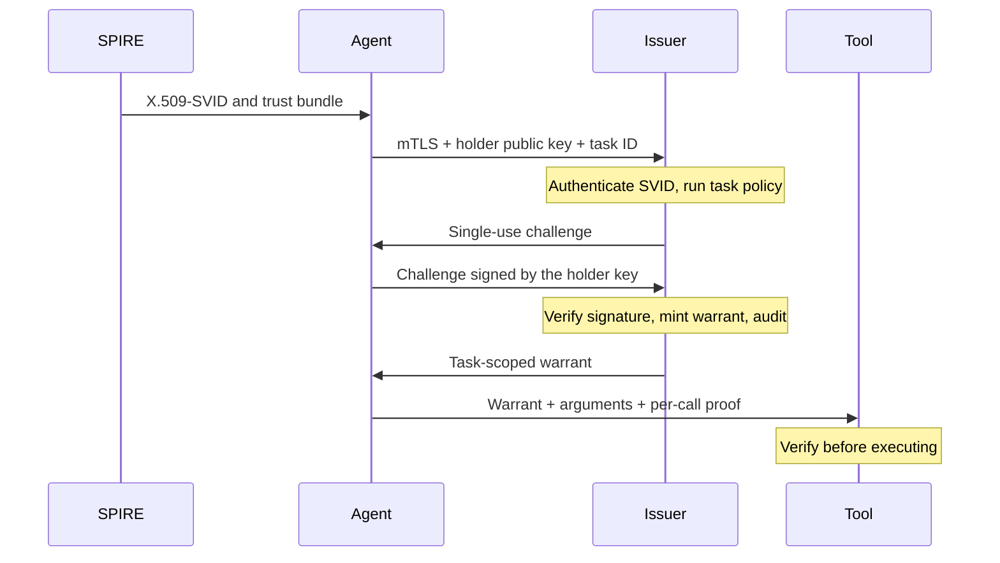

# SPIFFE and Tenuo: task-level authorization for workloads

> Exchange a workload's SPIFFE identity for a short-lived warrant that covers one task.

SPIFFE tells a service which workload is calling. It does not say what that
workload may do for the task in front of it, so a service usually keeps one
allowlist per workload, and every task an agent runs carries the whole
allowlist.

`tenuo.spiffe` adds the missing step. An agent proves its SPIFFE identity and
names a task. Your policy decides what that task needs. The agent gets a
warrant for exactly that: the refund agent working ticket 123 may refund
customer 123 up to $50 for the next two minutes, and may hand a smaller slice
to a worker. The refund tool checks the warrant on every call, which is what
lets you give an agent a write tool without giving it the whole API.

Your SPIRE deployment and existing workloads stay as they are. The issuer is
one more registered workload.

The adapter is Python. Agents in other languages can use the
[wire protocol](#wire-protocol), and tools can verify warrants with any Tenuo
SDK. We run the exchange on this page against SPIRE 1.16.0 in CI, including a
renewal of both SVIDs while the issuer is serving. The Python blocks that start
with a file name are executed by the test suite.

---

## How the pieces fit

| Question | Answered by | Carried in |
|---|---|---|
| Which workload is this? | SPIRE | An X.509-SVID, checked in the TLS handshake |
| What may it do for this task? | Your policy, run by the issuer | A warrant |
| May this call run? | Tenuo, at the tool | The warrant plus a per-call proof |



Three kinds of process are involved. Only the first two speak SPIFFE:

- **The issuer** is a small service you run. It holds the issuer key and your
  policy.
- **The agent** asks the issuer for a warrant when it starts a task.
- **The tool** (a refund API, an MCP server, a database wrapper) verifies
  warrants. It needs the issuer's public key and no SPIFFE code.

## Terms in two minutes

If you know SPIFFE, skim the second table. If you know Tenuo, skim the first.

| SPIFFE term | Meaning |
|---|---|
| Workload | One running program: here, the issuer or an agent. |
| Trust domain | The namespace one SPIRE deployment vouches for, such as `acme.test`. |
| SPIFFE ID | A URI naming a workload: `spiffe://acme.test/agents/refund`. |
| X.509-SVID | A short-lived certificate carrying one SPIFFE ID. |
| Trust bundle | The CA certificates of a trust domain. A peer's SVID must chain to one of them. |
| mTLS | TLS where both sides present a certificate. Here both present SVIDs. |
| SPIRE server and SPIRE agent | The server signs SVIDs. A SPIRE agent on each node checks which local process is asking (attestation) and hands it its SVID over the Workload API, a Unix socket. |
| Registration entry | A SPIRE server record: processes matching these selectors get this SPIFFE ID. A selector is a fact the SPIRE agent can check, such as `unix:uid:1001`. |
| `spiffe-helper` | A program that fetches an SVID from the Workload API, writes it to files, and rewrites them on renewal. |

On this page "agent" always means your AI agent workload. The SPIRE component
is always called "SPIRE agent".

| Tenuo term | Meaning |
|---|---|
| Warrant | A signed token listing tools, argument constraints, and an expiry, bound to one holder key. |
| Issuer key | The Ed25519 key that signs warrants. Tools trust its public half. |
| Holder key | An Ed25519 key the agent generates and keeps. The warrant names its public half. |
| Proof of possession | A signature the holder makes for each call over the tool name, arguments, and time. A copied warrant is useless without the holder key. |
| Constraint | A rule on one argument: `Exact("123")`, `Range(1, 5000)`, and others in [Constraints](constraints.md). |
| Delegation | The holder signs a narrower child warrant for another key. Verifiers check the whole chain. |

[Concepts](concepts.md) explains warrants in more depth.

## Try it in five minutes, without SPIRE

From a checkout of this repository:

```bash
python -m venv /tmp/tenuo-spiffe-demo-venv
/tmp/tenuo-spiffe-demo-venv/bin/pip install 'tenuo==0.3.8' 'cryptography>=42'
PYTHONPATH=tenuo-python /tmp/tenuo-spiffe-demo-venv/bin/python tenuo-python/examples/spiffe/demo.py
```

The released package supplies Tenuo's compiled core, and `PYTHONPATH` loads the
adapter from the checkout until it ships in a release. The demo creates
throwaway certificates shaped like SVIDs, runs an issuer and an agent on
localhost, and makes four tool calls:

```text
ALLOWED: approved customer, $40
DENIED: different customer
DENIED: over $50 task limit
ALLOWED: delegated worker, $8
Verified: only the two authorized refunds reached the tool body.
```

The [demo README](../tenuo-python/examples/spiffe/README.md) also has a Docker
harness that does the same against a real SPIRE server.

## Set it up with your SPIRE deployment

The steps use one trust domain (`acme.test`), one issuer, and one agent. Each
step says which machine it runs on.

### Before you start

- A working SPIRE server, and a SPIRE agent on each node that will run the
  issuer or an agent. The
  [SPIRE quickstarts](https://spiffe.io/docs/latest/try/) cover that part.
- Python 3.9 or newer for the issuer and the agents.
- The adapter: `pip install 'tenuo[spiffe]'` once it is released. Until then,
  install from a checkout with `python -m pip install './tenuo-python[spiffe]'`
  (needs Rust build tools).
- A registration entry for the issuer and one for each agent. Run on the SPIRE
  server:

  ```bash
  spire-server entry create -parentID spiffe://acme.test/node-a \
      -spiffeID spiffe://acme.test/issuer -selector unix:uid:1001
  spire-server entry create -parentID spiffe://acme.test/node-b \
      -spiffeID spiffe://acme.test/agents/refund -selector unix:uid:1002
  ```

  `-parentID` is the SPIFFE ID of the SPIRE agent on the node where the
  workload runs. `spire-server agent list` prints them. On Kubernetes the
  selectors are usually `k8s:ns:<namespace>` and `k8s:sa:<service account>`.
  Give the issuer and each agent different selectors, so one workload cannot
  obtain another's SVID.

### Step 1: Put SVIDs on disk

*On the issuer's machine and on each agent's machine.*

The adapter reads three PEM files: the SVID certificate, its private key, and
the trust bundle. It does not call the Workload API itself. Run
[`spiffe-helper`](https://github.com/spiffe/spiffe-helper) beside each
workload:

```hcl
# helper.conf
agent_address = "/run/spire/sockets/agent.sock"   # The SPIRE agent's socket.
cert_dir = "/run/spiffe"                          # Must already exist.
svid_file_name = "svid.pem"
svid_key_file_name = "svid_key.pem"
svid_bundle_file_name = "svid_bundle.pem"
key_file_mode = 0600
```

```bash
spiffe-helper -config helper.conf
```

SPIRE decides which SVID to hand out from who is asking. Run the helper as the
same Unix user (or in the same pod) as the workload it serves, so that it
matches the workload's selectors and the workload can read the key file.

The helper keeps running and replaces the files atomically when SPIRE renews
the SVID. Leave `include_federated_domains` off: the bundle file must hold only
your own trust domain's authorities, and the adapter cannot tell a foreign CA
from one of yours.

Check the result:

```bash
openssl x509 -in /run/spiffe/svid.pem -noout -text | grep URI:
```

```text
                URI:spiffe://acme.test/issuer
```

To try things once without the helper, `spire-agent api fetch x509 -write DIR`
writes `svid.0.pem`, `svid.0.key`, and `bundle.0.pem`. Those files are not
renewed.

### Step 2: Create the issuer key

*Once, on an administrator's machine.*

```python
# make_issuer_key.py
from pathlib import Path

from tenuo import SigningKey

key = SigningKey.generate()
private = Path("tenuo-issuer.pem")
private.touch(mode=0o600)
private.write_text(key.to_pem())
Path("tenuo-issuer.pub").write_text(key.public_key.to_pem())
```

This key is separate from any SVID key. It signs every warrant.

- Put `tenuo-issuer.pem` in your secret manager and mount it only into the
  issuer. This page assumes `/run/secrets/tenuo-issuer.pem`. All issuer
  replicas share it.
- Ship `tenuo-issuer.pub` to every agent and tool. This page assumes
  `/etc/tenuo/tenuo-issuer.pub`. It is public.

To rotate the key later, see [Issuer key rotation](#issuer-key-rotation).

### Step 3: Run the issuer

*On the issuer's machine.*

```python
# issuer.py
import asyncio
import logging
from pathlib import Path

from tenuo import Exact, Range, SigningKey
from tenuo.spiffe import SpiffeGrant, SpiffeIssuerServer, SpiffeTLS, SpiffeWarrantIssuer

logging.basicConfig(level=logging.INFO)
audit_log = logging.getLogger("acme.warrant-audit")

transport = SpiffeTLS(
    trust_domain="acme.test",
    bundle_file="/run/spiffe/svid_bundle.pem",
    cert_file="/run/spiffe/svid.pem",
    key_file="/run/spiffe/svid_key.pem",
    server_side=True,
)

# Stand-in for your task system: which workload may work on which task.
approved_tasks = {
    "refund-task-123": {"agent": "spiffe://acme.test/agents/refund", "customer": "123", "max_cents": 5000},
}


def policy(identity, task_id):
    task = approved_tasks.get(task_id)
    if task is None or task["agent"] != identity.spiffe_id:
        return None  # Deny.
    return SpiffeGrant(
        capabilities={"refund": {"customer": Exact(task["customer"]), "cents": Range(1, task["max_cents"])}},
        ttl_seconds=120,
        max_depth=1,  # The agent may delegate once. 0 forbids delegation.
    )


def audit(record):
    # Called before the warrant is released. If this raises, no warrant is sent.
    audit_log.info(
        "warrant=%s workload=%s task=%s holder=%s tools=%s expires=%s",
        record.warrant_id,
        record.identity.spiffe_id,
        record.task_id,
        record.holder,
        ",".join(record.tools),
        record.expires_at,
    )


issuer = SpiffeWarrantIssuer(
    tls=transport,
    signing_key=SigningKey.from_pem(Path("/run/secrets/tenuo-issuer.pem").read_text()),
    policy=policy,
    audit=audit,
)


async def main():
    async with SpiffeIssuerServer(issuer, host="0.0.0.0", port=8443) as server:
        await server.serve_forever()


asyncio.run(main())
```

Run `python issuer.py`. It prints one line and waits:

```text
INFO:tenuo.spiffe:Issuing warrants on 0.0.0.0:8443 as spiffe://acme.test/issuer
```

The server needs no web framework, and it reloads the SVID files as SPIRE
renews them. [Writing the policy](#writing-the-policy) covers the part you will
replace: `approved_tasks`.

### Step 4: Request a warrant in the agent

*On the agent's machine.*

```python
# agent.py
from pathlib import Path

from tenuo import PublicKey, SigningKey
from tenuo.spiffe import SpiffeTLS, request_warrant

transport = SpiffeTLS(
    trust_domain="acme.test",
    bundle_file="/run/spiffe/svid_bundle.pem",
    cert_file="/run/spiffe/svid.pem",
    key_file="/run/spiffe/svid_key.pem",
    server_side=False,
)
holder_key = SigningKey.generate()  # Never leaves this process.

warrant = request_warrant(
    transport,
    ("issuer.acme.internal", 8443),
    issuer_id="spiffe://acme.test/issuer",
    issuer_key=PublicKey.from_pem(Path("/etc/tenuo/tenuo-issuer.pub").read_text()),
    holder_key=holder_key,
    task_id="refund-task-123",
)
print(warrant.id, warrant.tools, warrant.expires_at())
```

Run `python agent.py`. It prints the new warrant:

```text
tnu_wrt_01a21496aecb7932bff93ec30b660e44 ['refund'] 2026-11-25T21:34:29+00:00
```

and the issuer logs the issuance and your audit line.

`request_warrant` checks the issuer's SPIFFE ID before it sends anything. It
also checks that the warrant it gets back is signed by `issuer_key`, bound to
`holder_key`, and unexpired. Every failure raises `SpiffeError` with a message
that says what went wrong; [Troubleshooting](#troubleshooting) lists them.
`arequest_warrant` is the same call for asyncio code.

In a real agent, build one `SpiffeTLS` and one holder key at startup and
request a new warrant for each task.

### Step 5: Call the tool, and verify at the tool

The agent signs each call with its holder key and sends three things over
whatever transport it already uses: the warrant, the arguments, and the proof.
Append this to `agent.py`:

```python
# call_tool.py  (append to agent.py)
import base64
import time

args = {"customer": "123", "cents": 4000}
proof = warrant.sign(holder_key, "refund", args, int(time.time()))
call = {"chain": [warrant.to_base64()], "args": args, "proof": base64.b64encode(proof).decode()}
```

*On the tool's machine*, check the call before doing anything:

```python
# tool.py
import base64
from pathlib import Path

from tenuo import Authorizer, PublicKey, Warrant
from tenuo.exceptions import TenuoError

authorizer = Authorizer(trusted_roots=[PublicKey.from_pem(Path("/etc/tenuo/tenuo-issuer.pub").read_text())])


def refund(call):
    try:
        chain = [Warrant.from_base64(item) for item in call["chain"]]
        authorizer.check_chain(chain, "refund", call["args"], base64.b64decode(call["proof"]))
    except (TenuoError, KeyError, TypeError, ValueError) as denied:
        return f"denied: {denied}"
    # Only now touch the payment system.
    return f"refunded {call['args']['cents']} cents to customer {call['args']['customer']}"
```

`refund(call)` returns `refunded 4000 cents to customer 123`. Change the
customer to `999` or the amount to `6000` and it returns `denied: ...`, even
though the agent's SVID is perfectly valid. `check_chain` verifies the issuer
signature, the expiry, the proof, and the actual arguments.

If the tool is a FastAPI route or an MCP server, use the [FastAPI](fastapi.md)
or [MCP](mcp.md) guide instead of writing this function: they carry the same
three values in headers or request metadata. Write it by hand for anything
else.

A proof is valid for a short window (150 seconds by default,
`Authorizer.pop_validity_secs()`), so keep clocks synchronized to within about
a minute, and make side effects idempotent: the same call can be repeated
inside that window.

### Step 6: Delegate a narrower warrant (optional)

Because the policy set `max_depth=1`, the agent can hand part of its authority
to a worker without going back to the issuer. The child can only be narrower.
Append this to `agent.py`, after the step 5 code:

```python
# delegate.py  (append to agent.py)
from tenuo import Exact, Range

worker_key = SigningKey.generate()  # In a real system the worker generates this and sends you the public half.
child = (
    warrant.grant_builder()
    .holder(worker_key.public_key)
    .ttl(30)
    .capability("refund", customer=Exact("123"), cents=Range(1, 1000))
    .grant(holder_key)
)

worker_args = {"customer": "123", "cents": 800}
worker_proof = child.sign(worker_key, "refund", worker_args, int(time.time()))
worker_call = {
    "chain": [warrant.to_base64(), child.to_base64()],
    "args": worker_args,
    "proof": base64.b64encode(worker_proof).decode(),
}
```

The tool code from step 5 accepts `worker_call` unchanged and denies the worker
anything over 1000 cents. Send the worker both warrants over the channel you
already use to hand it work. Warrants and public keys are not secrets: a
warrant is only usable with its holder's private key. They do reveal the scope
of the task.

---

## Writing the policy

The policy is the one piece only you can write. It receives the authenticated
identity and the task ID, and returns a `SpiffeGrant` or `None`.

**Where task records come from.** Tenuo does not provide the task system. In
most deployments it is whatever already assigns work to agents: an
orchestrator, a ticket queue, a workflow engine. When that system assigns a
task, it records which workload gets it and what the task needs (customer,
limit, tools), and passes the agent the task ID with the work. The policy reads
that record. The agent supplies only the ID, never the scope.

The rules:

- `identity.spiffe_id` is the workload's SPIFFE ID, already verified.
- `task_id` is a string of 1 to 256 characters chosen by the caller. Treat it
  as a lookup key. Check in your task system that this workload is assigned to
  it, and never parse scope out of the ID itself.
- The task system must be one that agents cannot write to. An agent that can
  create its own task record can grant itself anything.
- Return `None` to deny. An authenticated workload has no default grant.
- Every tool needs constraints. To allow any arguments on purpose, write
  `{"search": ANY_ARGUMENTS}`. An empty dict is rejected, so a forgotten
  constraint cannot become an open grant.
- `ttl_seconds` defaults to 300. Choose the time the task should take, not the
  life of the agent. The warrant also never outlives the caller's SVID.
- `max_depth` defaults to 0 (no delegation) and may be at most 64.
- The policy runs once per request, in a worker thread, before the agent gets a
  challenge. It may block on a database. If it raises, the agent sees
  `Issuer error; see the issuer's log` and no warrant is issued.

A warrant limits each call, not the total. `Range(1, 5000)` on `cents` allows
many $50 refunds until the warrant expires. Keep idempotency keys and running
totals in the refund service.

## Credential rotation

SPIRE's default X.509-SVID lifetime is one hour (`default_x509_svid_ttl`), and
SPIRE renews an SVID at about half its lifetime. A long-running issuer
therefore has to pick up new files many times a day. The adapter handles this:

- `SpiffeIssuerServer` checks the three files every `reload_interval` seconds
  (default 30). `request_warrant` checks them before each request.
- New handshakes use the newest SVID and bundle. Listeners are not rebuilt and
  open connections are not dropped.
- If a reload fails (a half-written file, a key that does not match, an SVID
  for another trust domain, an expired SVID), the adapter keeps the credentials
  it has, logs a warning, and tries again at the next check.
- It also warns when the local SVID is in the last fifth of its lifetime and
  has not been renewed. That warning usually means the helper has stopped.
- When a reload removes an authority from the bundle, connections verified
  under the old bundle are refused and must reconnect. TLS session resumption
  is disabled, so a removed authority cannot be carried forward that way.

If you embed `SpiffeTLS` in your own server, call
`transport.reload_if_changed()` on a timer, or `transport.reload()` when your
helper signals a renewal.

### Issuer key rotation

The issuer key is yours to rotate; SPIRE does not manage it.

1. Generate a new key (step 2).
2. Add the new public key everywhere, next to the old one. Tools take a list:
   `Authorizer(trusted_roots=[old, new])`. So do agents:
   `request_warrant(..., issuer_key=[old, new])`.
3. Switch the issuer to the new private key and restart it.
4. After the longest warrant lifetime has passed, remove the old public key.

## Limits and defaults

| Setting | Default | Where |
|---|---|---|
| Challenge lifetime | 30 seconds, single use | fixed |
| Outstanding challenges, total | 1024 | `SpiffeWarrantIssuer(max_pending=)` |
| Outstanding challenges, per SPIFFE ID | 16 | `SpiffeWarrantIssuer(max_pending_per_identity=)` |
| Open connections, counted from accept | 256 | `SpiffeIssuerServer(max_connections=)` |
| Issuer deadline for handshake plus exchange | 10 seconds | `SpiffeIssuerServer(timeout=)` |
| Agent socket timeout | 10 seconds | `request_warrant(timeout=)` |
| Policy and audit threads | 32 | `SpiffeIssuerServer(max_workers=)` |
| Credential file check | every 30 seconds | `SpiffeIssuerServer(reload_interval=)` |
| Frame size | 64 KiB | fixed |
| Bytes accepted per connection | 256 KiB | fixed |
| Warrant lifetime | 300 seconds, capped by the SVID | `SpiffeGrant(ttl_seconds=)` |
| Delegation depth | 0 | `SpiffeGrant(max_depth=)` |

- With `SpiffeIssuerServer`, the 10-second deadline ends an exchange before
  the 30-second challenge lifetime matters. The challenge lifetime applies when
  you use the [lower-level API](#lower-level-api).
- A request is refused once 16 challenges for the same SPIFFE ID are already
  outstanding. Raise `max_pending_per_identity` if many replicas share one
  SPIFFE ID and start tasks at the same moment.
- Connections over `max_connections` are closed at once. Also limit new
  connections per source at the firewall or the layer-4 load balancer.
- If the deadline passes while `audit` is still running, the audit call
  finishes but the agent gets no warrant. An audit log can therefore hold a
  warrant that was never delivered. It cannot miss one that was.

## Deployment notes

- **TLS must end in the issuer process.** The adapter reads the peer SVID from
  the live TLS connection. Put only TCP (layer 4) load balancers in front of
  it. A proxy that terminates TLS and forwards an identity header will not
  work, by design.
- **Service meshes.** A sidecar that intercepts the issuer port would end the
  mTLS session itself. Exclude that port from capture. With Istio, the pod
  annotations are `traffic.sidecar.istio.io/excludeInboundPorts` on the issuer
  and `traffic.sidecar.istio.io/excludeOutboundPorts` on agents
  ([Istio annotation reference](https://istio.io/latest/docs/reference/config/annotations/)).
- **Replicas.** Run as many issuer replicas as you like with the same issuer
  key. An exchange uses one connection from start to finish, so no session
  affinity is needed.
- **Kubernetes.** Run `spiffe-helper` as a sidecar container in the same pod,
  sharing an in-memory `emptyDir` volume mounted at `/run/spiffe`, with the
  SPIRE agent socket mounted into the helper. We do not ship a manifest for
  this yet. [Kubernetes Integration](kubernetes.md) covers the Tenuo side.
- **Web frameworks.** Uvicorn, Hypercorn, and gRPC do not give application
  code the TLS connection object, so the issuer cannot be a route in those
  servers. Run `SpiffeIssuerServer` on its own port beside them.
- **What to watch.** On the `tenuo.spiffe` logger: the warnings
  `Could not reload SPIFFE credentials` and `has not been renewed` (the helper
  is failing), the error `Issuance exchange failed` (your policy or audit
  raised), and the rate of `Issuance refused` lines.

## Troubleshooting

The agent gets a `SpiffeError` with one of these messages. The issuer logs the
matching reason on the `tenuo.spiffe` logger.

| Message | Likely cause | Fix |
|---|---|---|
| `The SVID presented by HOST:PORT was not accepted: ...` | The issuer's SVID does not chain to the agent's bundle, or has expired. | Check both sides use the same trust domain's bundle and that the issuer's helper is running. |
| `TLS with the issuer at HOST:PORT failed: TLSV1_ALERT_UNKNOWN_CA` | The issuer does not trust the agent's SVID. | The same check, from the issuer's side. |
| `Could not complete the exchange with the issuer at HOST:PORT: ...` | Connection refused, reset, or timed out. A reset can mean the issuer is at `max_connections`. | Check the address, the network path, and issuer load. |
| `Connection closed before a reply` | The issuer's 10-second deadline passed, usually a slow policy or audit call. | Check policy latency in the issuer log. |
| `Unexpected peer SPIFFE ID` | `issuer_id` is not the ID on the issuer's SVID. | Compare with the issuer's registration entry. |
| `SVID belongs to a different trust domain` | `trust_domain` does not match the SVID. | Fix the `SpiffeTLS` argument or the files. |
| `Local SVID is not currently valid` (at startup) | The SVID file is stale. | The helper is not running or cannot reach the SPIRE agent. |
| `Trust bundle may contain only CA certificates` | `bundle_file` points at the SVID or another non-CA file. | Point it at the bundle file. |
| `Issuer refused: Workload is not authorized for this task` | The policy returned `None`. | Check the task record and the caller's SPIFFE ID in the issuer log. |
| `Issuer refused: Too many pending holder challenges for this workload` | 16 requests from one SPIFFE ID are unfinished. An abandoned request holds its slot for 30 seconds. | Raise `max_pending_per_identity`, or find the agents that open requests and stop. |
| `Issuer refused: SVID expires too soon to issue a warrant` | The agent's SVID has about a second left. | The agent's helper is not renewing. |
| `Issuer error; see the issuer's log` | The policy or audit callback raised. | Read the traceback in the issuer log. |
| `Challenge is from a different issuer key` | The agent's `issuer_key` is not this issuer's key. | Redistribute `tenuo-issuer.pub`. |
| Tool returns `denied: Root warrant issuer is not trusted` | The tool has a different issuer public key. | Redistribute it. |

A grant the issuer will not sign is reported to the agent as `Issuer refused:`
followed by the reason, for example `Empty constraints for 'search'; use
ANY_ARGUMENTS to allow any arguments` or `Policy grant has invalid
constraints`.

---

## Reference

### Lower-level API

To issue warrants from a server you already run, terminate TLS with
`transport.context` and pass the live `SSLSocket` or `SSLObject` to the issuer:

```python
challenge = issuer.challenge(tls_connection, holder_public_key, "refund-task-123")
# Agent: signature = sign_holder_challenge(challenge, holder_key, task_id=..., issuer_key=...)
warrant = issuer.issue(tls_connection, challenge, signature)
```

Two rules apply on the agent side:

- Call `transport.authenticate(connection, expected_id=...)` before sending
  anything. The bundle proves the server belongs to your trust domain. Only
  this check proves it is the issuer.
- Sign challenges with `sign_holder_challenge`, never with `sign_raw`. The
  helper refuses anything that is not a challenge for this holder key and task,
  and the issuer rejects signatures made any other way.

### Wire protocol

Agents in other languages can speak to `SpiffeIssuerServer` directly. Each
connection carries one exchange of four newline-terminated JSON objects over
mTLS (TLS 1.2 or newer, both sides presenting X.509-SVIDs, no session
resumption). Binary values are standard base64. Frames with missing or extra
keys are refused.

| Step | Direction | Frame |
|---|---|---|
| 1 | agent to issuer | `{"v": 1, "holder": "<32-byte Ed25519 public key>", "task": "<task ID>"}` |
| 2 | issuer to agent | `{"challenge": "<challenge bytes>"}` |
| 3 | agent to issuer | `{"signature": "<64-byte Ed25519 signature>"}` |
| 4 | issuer to agent | `{"warrant": "<warrant, as Warrant.to_base64 produces>"}` |

At step 2 or 4 the issuer may instead send
`{"error": "refused", "message": "<reason>"}` for a refusal, or
`{"error": "unavailable", "message": "Issuer error"}` when its policy or audit
callback failed, and close.

The challenge is UTF-8 JSON with sorted keys and no whitespace. Its fields are
`nonce` (64 hex characters), `issuer` (issuer public key, hex), `spiffe_id`,
`certificate` (SHA-256 of the agent's SVID, hex), `holder` (hex), and
`task_id`. Before signing, the agent must check that `holder` and `task_id`
are its own and that `issuer` is a key it trusts. The signature is Ed25519
over the 30 ASCII bytes `tenuo.spiffe.holder-binding.v1`, then one zero byte,
then the challenge bytes exactly as received.

### What this adapter does not do

- **JWT-SVIDs, federation, and forwarded identity headers** are not supported.
  One `SpiffeTLS` trusts one trust domain's bundle.
- **It does not revoke.** Removing a workload's registration entry stops new
  warrants once its SVID expires. Warrants already issued stay valid until
  their own expiry, so keep lifetimes short, or distribute a revocation list
  to your verifiers ([Revocation](security.md#revocation)).
- **A warrant does not prove a SPIFFE ID to the tool.** It proves the issuer
  approved this holder key for this scope. The audit record links the two.
- **It does not judge the task.** If the task system says the refund agent may
  work ticket 123, the issuer believes it.

### API summary

| Name | Purpose |
|---|---|
| `SpiffeTLS(trust_domain=, bundle_file=, cert_file=, key_file=, server_side=)` | Loads and reloads credentials. `authenticate(connection, expected_id=)` returns a `SpiffeIdentity`. |
| `SpiffeWarrantIssuer(tls=, signing_key=, policy=, audit=, max_pending=, max_pending_per_identity=)` | Runs policy, challenges the holder key, mints warrants. |
| `SpiffeIssuerServer(issuer, host=, port=, max_connections=, timeout=, reload_interval=, max_workers=)` | The mTLS endpoint. `async with` it, then `serve_forever()`. |
| `request_warrant(tls, address, issuer_id=, issuer_key=, holder_key=, task_id=, timeout=)` | Agent-side call. `arequest_warrant` for asyncio. `issuer_key` may be a list. |
| `SpiffeGrant(capabilities, ttl_seconds=300, max_depth=0)` | What a policy returns. |
| `ANY_ARGUMENTS` | Explicit "no argument constraints" for one tool. |
| `SpiffeIdentity` | `spiffe_id`, `certificate_sha256`, `expires_at`. |
| `SpiffeIssuance` | The record passed to `audit`. |
| `sign_holder_challenge(...)` | Agent-side signing for the lower-level API. |
| `SpiffeError` | Raised for every refusal and client failure. A subclass of `ValueError`. |

### Further reading

- [SPIFFE ID specification](https://spiffe.io/docs/latest/spiffe-specs/spiffe-id/)
- [X.509-SVID specification](https://spiffe.io/docs/latest/spiffe-specs/x509-svid/)
- [SPIRE server configuration](https://spiffe.io/docs/latest/deploying/spire_server/) and [SPIRE agent configuration](https://spiffe.io/docs/latest/deploying/spire_agent/)
- [spiffe-helper](https://github.com/spiffe/spiffe-helper)
- [Runnable demo and real SPIRE harness](../tenuo-python/examples/spiffe/README.md)
